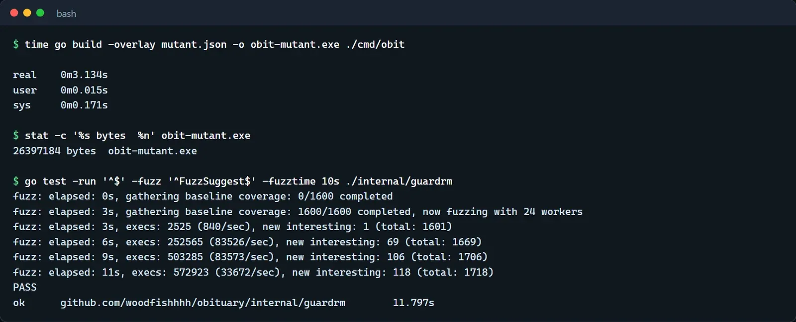
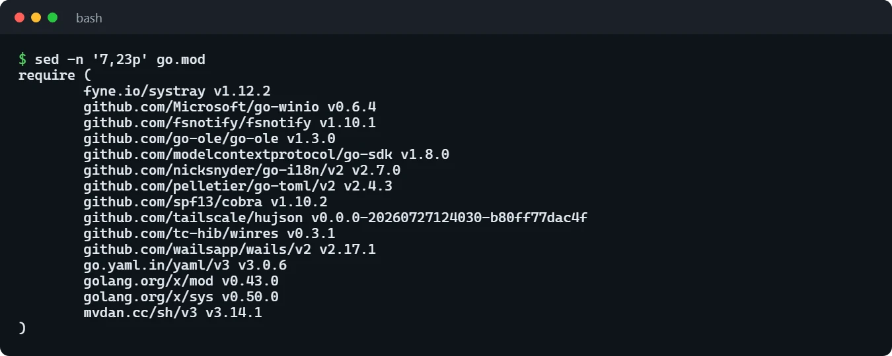

讣告用 Go 写，这个选择在第一个晚上就做了。11 月 8 日下午，它又被认真问了一遍：当时已经有大约 1.36 万行产品代码和 1.7 万行测试，审过 22 轮，要不要改成 Rust？我们的答案是不改。几条具体的约束都落在 Go 这一边，每一条都能在代码和测试里找到对应。

## 最初推荐 Rust 的理由

第一版方案推荐的其实是 Rust 全栈。当时的想法是，Windows 11 的新式右键菜单需要一个加载进 explorer.exe 的 COM DLL，Go 的运行时不适合放进资源管理器进程，所以整个工程用 Rust 写最干净，命令行、后台进程和扩展 DLL 可以放在同一个工程里。备选方案是命令行和后台进程用 Go，只把那个很小的 DLL 留给 C++ 或 Rust。我们当时正在学 Go，选了后者，计划书里写的是到做桌面体验的阶段，再单独写那个 DLL。

这个 DLL 最后没有写。右键菜单走的是经典的注册表方式，在 Windows 11 里出现在“显示更多选项”下面，所以当初推荐 Rust 的主要理由，实际上从来没有用上。

## 真正起作用的约束

讣告装在用户的机器上，被 agent 频繁调用，每次 agent 写文件或执行删除，都会拉起一个 hook 进程。语言要同时满足四条约束。

第一条是分发和启动。我们需要单个二进制，不依赖任何运行时，冷启动要快。hook 每次都是一个新进程，Node 的冷启动慢，还要求用户先装 Node，所以 TypeScript 在这里就排除了。

第二条是直接调用系统接口。讣告要用 128 位文件 ID 核对身份，在同一个句柄上改名，还要通过 COM 接口把东西送进回收站。Go 用 `x/sys/windows` 加 `syscall.SyscallN` 就能直接调用 Win32 和 COM，当时的代码里没有一处 cgo，交叉编译也只要一条命令。C++ 也能做到，但构建、分发和内存安全的成本更高。当时 `GOOS=linux` 其实还编译不过，因为命令行直接依赖了 Windows 的包，这一点在随后几天做 macOS 和 Linux 时补上了。

第三条最关键，讣告的风险在语义上，不在内存上。要防的是误删、检查和移动之间的竞态窗口、文件身份被替换，我们的判断是 Rust 的借用检查对这类问题帮助有限，真正起作用的是测试。Go 的测试工具链对此很直接：每个测试包用 `TestMain` 把用户目录指到一次性目录，再用 `go test -overlay` 做编译级的变异检查，证明每道安全检查都有测试守着。

第四条是迭代速度。Go 编译只要几秒，代码风格统一，审查成本低，而这个项目的头两天基本就是 40 轮审查加修复。官方的 MCP Go SDK 也是现成的。

## 编译速度和 bash 解析

后来的事实让第三、第四条变得更具体。变异检查要给每个变异体重新编译一遍，所以编译速度决定安全测试跑不跑得起来。下面这个构建是在这台机器上量的：改一行源码之后，把整个命令行程序重新编译、链接成 26 MB 的开发版可执行文件，用了 3.1 秒。图里接着是 Go 自带的模糊测试，10 秒里跑了五十多万个输入。

<figure>
  
  <figcaption>同一台机器上的两段真实输出：上面是增量构建的计时，下面是模糊测试每秒执行的次数。</figcaption>
</figure>

另一个原因出在删除护栏上。护栏要判断一条 shell 命令里哪些词真的会被当作命令执行，这需要精确解析 bash，引号、heredoc、命令替换都要分清。Go 里有 shfmt 用的解析器 `mvdan.cc/sh`，被大量真实脚本检验过，我们直接用它。Rust 一侧也有 bash 解析库，我们没有写过 Rust 版本，所以没有拿它们做过对比。

<figure>
  
  <figcaption>go.mod 里列出的直接依赖，核心部分用的都是现成的库。</figcaption>
</figure>

## 把 Go 的长处真正用起来

那天下午的追问还促成了一件实事。我们回头核对代码，发现生产代码里没有一个 goroutine，测试里没有一处 `t.Parallel()`，也还没有模糊测试。其中一部分是有意的：账本写入和下葬必须一个一个来，并发只会去抢同一把锁，还会扩大出错的时间窗；hook 的耗时主要花在启动进程上，加 goroutine 没有用。真正慢的地方在别处，比如逐个路径去问 git，和串行的测试。

于是我们排了一次 Go 能力整理，顺序是先量，再模糊，再改。模糊测试覆盖了 11 个解析不可信输入的入口，累计约 2000 万次执行，找到的问题里有一个是 `.obitrules` 的字符范围写成 `[.-0]` 时会跨过目录分隔符，扩大自动登记的范围。hook 在已同意的项目里写文件之后，少问一次 git，进程内处理时间从约 180 毫秒降到约 88 毫秒，真实进程从约 490 毫秒降到约 300 毫秒。一次清理 1000 个到期条目，从约 100 秒降到 19.5 秒，后台火化 1000 项从 78 秒降到约 4 秒。425 个顶层测试和 97 处子测试改成了并行。

同一天还讨论了单写者账本：一个常驻进程独占账本，其他命令把请求发给它，由它排队执行。这是成熟的做法，但当时讣告没有常驻进程，所以放到托盘进程出现之后再做。

什么情况下我们会重新考虑 Rust？讣告需要作为库嵌进别的 Rust 程序，或者出现某个只有 Rust 才有、又绕不开的能力。到现在，这两种情况都没有出现。
