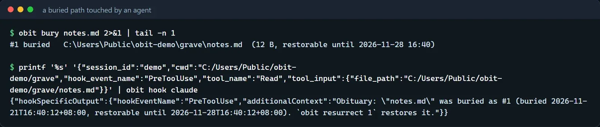
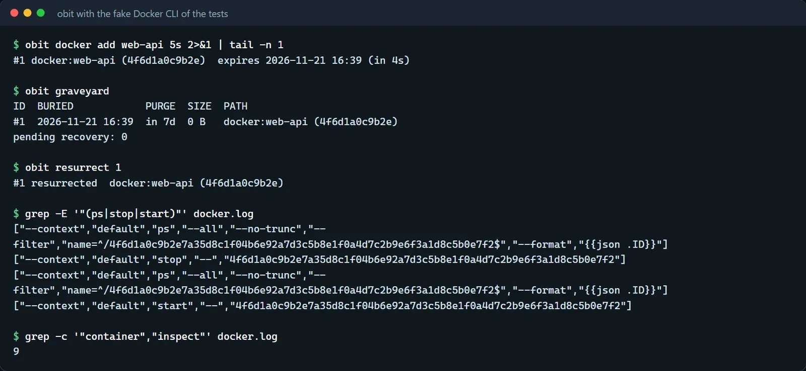

产品故事和代码有出入的时候，我们的办法是把故事记成需求。11 月 11 日凌晨这样做了两次，一次是墓地提醒，一次是 Docker 容器。

## 故事里的那件事

讲产品故事时说到这样一个场景：不确定一个文件有没有用，先下葬，如果之后七天里有 AI 用到它，它会注意到这个文件已经被下葬，然后把它复活。我们回头核对代码，发现做不到。agent 只在会话开始时听说 24 小时内到期的东西和上次留下的东西，一个文件被下葬之后，再有工具调用去用到这个路径，没有任何提示，agent 只会看到文件不存在。

## 墓地提醒

现在的做法是这样。agent 的工具调用引用了一个不存在、但墓地里还能复活的路径，也就是下葬的那个路径本身，或者下葬目录里面的路径，讣告就告诉它墓地里的编号、什么时候下葬、还能复活到什么时候，以及一条 `obit resurrect <编号>`。只提醒，不拒绝，也不改写它的调用，同一个会话里每座坟只提醒一次。能在工具调用之前附加上下文的宿主当场提醒，其他宿主退到下一个能投递上下文的时机，各家支持到哪一级写在能力表里。下面是真实运行的结果：先埋掉一个文件，再把 agent 读这个文件的调用交给 hook。

<figure>
  
  <figcaption>墓地提醒的真实输出。agent 读一个已经下葬的文件时，hook 返回的上下文里有编号、下葬时间、可复活的截止时间和复活命令，调用本身不受影响。</figcaption>
</figure>

提醒发生在每个工具调用之前，所以它必须很轻。PreToolUse 过去从来不碰账本，现在只有路径不存在时才读账本，而且只在 25 毫秒的共享锁预算内读，拿不到锁就跳过这次提醒。账本每次写入之后会重建一份只记路径的索引文件，用它先排除无关的路径，它本身不算依据，命中之后才读账本核对。路径按原样的大小写比较，宁可漏提醒。会话开始时还可以列出本项目最近下葬、仍可复活的东西，`obit mktemp` 的临时目录和本会话自己下葬的不算。这份开工清单当晚就改成默认关闭，为的是省 agent 的 token，要用的话在小窗口的设置里或者 `config.toml` 的 `[hooks] session_summary` 里打开。

## Docker 容器

同一个凌晨来了另一个需求。agent 在会话里 `docker run`、`docker compose up`，容器开了一个又一个，几天之后没有人记得哪个是干什么的，哪些可以删。

11 月 11 日做的第一版只管容器，不删镜像、卷和网络。现在容器下葬仍不会连带删除卷；要处理卷，得用 `--docker-volume` 明确登记或下葬。镜像和网络仍不删除。

当时登记容器有两种方式。`obit docker add <容器> <寿命>` 明确登记。agent 会话期间新建的容器，会话结束后列成待你决定的提议，批准才登记，能归到项目的，也就是 compose 的工作目录指向项目，或者绑定挂载在项目里的，归到项目。

到期的动作是 `docker stop`，容器和它的可写层都还在，复活就是 `docker start`。保留期过后的火化是 `docker rm`，不带 `-v`，也不带 `-f`。所有操作都按完整的容器 ID 进行，名字只用来显示，每次动手前重新 inspect，ID 和创建时间对不上就不动。火化时容器如果正在运行，说明它被复活了或者被人手动启动了，按复活处理，不删除。设了 `--rm` 的容器停下来 Docker 自己就会删掉它，讣告拒绝登记这样的容器。

Docker 解析引用的顺序是完整 ID、精确名字、ID 前缀。如果原来的容器恰好消失，别的容器又被改名成这串完整 ID，按 ID 下的命令就会落到那个容器上，所以动手前讣告会检查有没有容器的名字等于这个完整 ID，有就不动。下面用测试里的假 Docker 命令行把这条路径走了一遍，上半截是讣告的输出，下半截是假 Docker 记下来的、讣告发给它的命令。stop 和 start 之前各有一条这样的 `ps` 检查，整个过程一共 inspect 了 9 次。

<figure>
  
  <figcaption>用测试里的假 Docker 命令行真实运行的结果。容器到期时被 stop，复活时被 start，命令里始终是完整的容器 ID，没有 -f，也没有 -v。</figcaption>
</figure>

Docker 调用比文件操作慢得多，一次 `docker stop` 要等容器自己的停止超时，十几秒很常见，所以 Docker 调用既不放在 hook 里，也不放在账本锁里。每个操作分两步：先在锁内核对条目、写下容器意图并提交，再在锁外调用 Docker，最后回到锁内核对意图仍是这一次的，提交结果并清掉意图。中途崩溃时，恢复只观察，不重复有破坏性的操作：运行中的容器绝不记成已下葬，有删除意图而容器已经不在就补记火化，没有执行的意图清掉后按原寿命重试。登记、提议和意图还会记下当时的 Docker 上下文或端点，以及 daemon 的 ID，之后每次调用都显式指定，daemon 对不上就不动。

从决定到第二轮复审，整件事在凌晨 1 点多到 5 点多之间做完。两天之后容器提议又收窄了一次：只有 compose 工作目录或绑定挂载落在会话项目里的容器才会被提议，只靠时间窗归到这个会话的不再列出，因为它可能是用户自己在别处起的。漏提议只是少清理，不会误删。现在自动登记默认关闭，不打开它的话，讣告不会去找容器，只有 `obit docker add` 登记的才有寿命。讣告调用的是 `docker` 命令行，也就是 Docker Desktop 或 Docker Engine 自带的那一个。
