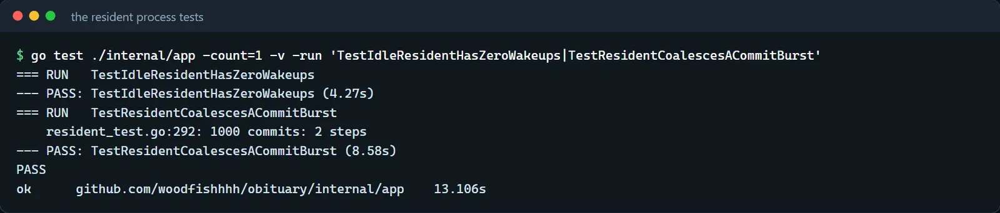

常驻进程 `obitd` 的职责是等：等文件夹里的文件变化，等下一个到期的时间。它空闲的时候应该几乎不占 CPU。11 月 14 日晚上的一次体检里，我们发现它空闲时占着约 0.37 个 CPU 核。

## 差了将近 20 倍

这个数字很不正常，一个只在后台等文件到期的进程，空闲时应该接近 0。我们立刻重新量了一次，这回只有 0.02 个核。两次相差将近 20 倍，说明问题出在文件大量变动的时候。只测空闲状态，发现不了这类跟负载有关的问题。

于是交给 worker 的任务从复现开始。同一段时间里同时量 `obitd` 和一个常驻的文件搜索工具，再故意批量创建、删除一万个文件，看 `obitd` 怎么飙。接着是找根因，要排查托盘是不是在不停刷新，后台多久扫一次，文件监视的范围是不是太大，每个文件事件是不是都触发了一次全量扫描，能拿到 CPU 剖面就用 pprof 定位。最后是修根因，不准靠降低检查频率糊弄过去，修完用同样的办法再量一遍，前后的数字都要给出来。

## 根因在没想到的地方

我们从代码里看到托盘每秒轮询一次，以为那就是主因。剖面显示真正的大头在别处：资源管理器标签的同步，每检查一个被跟踪的文件夹，都要把整棵目录树，包括里面的 `node_modules`，翻一遍去找 `.git`。同步在每一次定时检查里，对每一个被跟踪的文件夹都做这件事。如果只按猜测去改托盘的轮询，修完 CPU 还是会高。修复是让这类强制的检查不再为了找仓库去遍历目录，这笔开销原来由资源管理器标签来付，每个被跟踪的文件夹、每一次检查都付一遍。

## 只靠事件醒来

找到根因之后，常驻进程的唤醒方式一并改了。现在它只在这几种情况下醒来：数据目录或配置目录里有文件变化，下一个到期时间到了，或者每 5 分钟一次的全量对账，这是唯一的定时。一串连续的事件合并成一次处理，安静 300 毫秒就处理，最多推迟 2 秒。进程自己的账本提交不会再唤醒自己，办法是比较账本的修改时间。墓地的引用没变就不重读，推迟处理的观察事件不用跑完整的一轮检查就能补上。托盘不再定时去看配置，改成监视 `config.toml`。文件夹策略的监视在一串事件平息之后才处理，账本提交时也不再重新扫描文件夹。

这条规矩写进了 `AGENTS.md`：常驻进程和托盘不定时轮询，只靠事件醒来，唯一的定时是 5 分钟一次的全量对账，连续事件合并，自己的提交不唤醒自己。以后新增任何唤醒来源，都要同时加一条空闲零唤醒的测试。这类测试有两条。第一条让常驻进程先跑完第一轮，也就是把一个到期的文件下葬，这是它自己的提交，然后往数据目录里写日志和审计这类文件，再等上两倍的最长合并窗口，进程只能处理过那一轮，不准再多一次。第二条从另一个进程连续提交 1000 次账本，数一数常驻进程处理了几轮，上限是 3 轮。

<figure>
  
  <figcaption>两条测试的真实运行。空闲时的常驻进程除了第一轮不再处理任何东西，一千次连续的账本提交只引起 2 轮处理。</figcaption>
</figure>

## 前后的数字

1.3.0 发布时，前后的数字是在一台账本里有几百个条目的机器上量的。账本连续写入时，也就是 agent 干活时的样子，200 次账本提交，每次的 CPU 时间从 1.2.1 的 2.9 秒降到 0.15 秒，折合后台占用从约 2.9 个核降到 0.2 个核。空闲时包含一次 5 分钟的例行检查，平均占用从 0.15 个核降到 0.03 个核。

<figure>
  
  <figcaption>同一台机器、同一份真实账本上的前后对比。写入期间每次的开销降到不到二十分之一，空闲时降到五分之一。</figcaption>
</figure>

这个修复放进了 1.3.0，11 月 15 日凌晨 3 点半发布。
