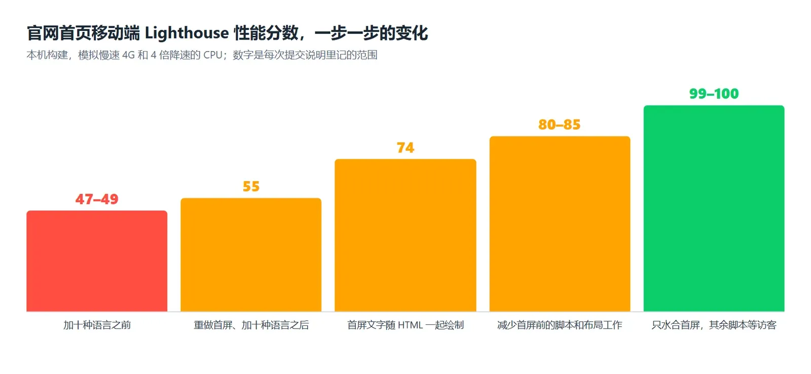
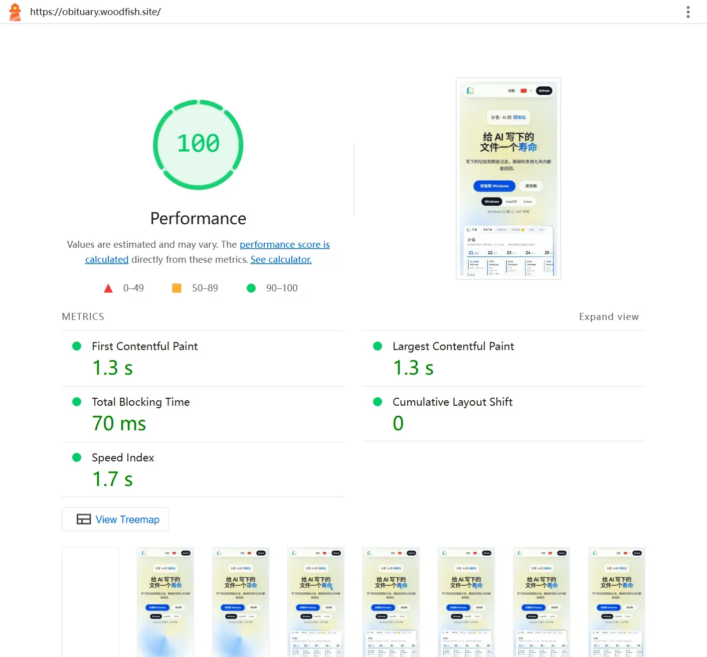

11 月 20 日深夜，官网的首屏换成了桌面小窗口的真组件，跑在示例数据上，访客可以悬停、选中、续命、拖到别的日子。这个首屏有很多动画和脚本，在手机上很慢。

用 Lighthouse 的移动端设置，模拟慢速 4G 和 4 倍降速的 CPU，它只得了 55 分，换之前的旧版本是 47 到 49 分。

**三个多小时之后，同样的测法，同一份本机构建是 99 到 100 分。**

| 步骤 | 时间 | 移动端分数 |
|---|---|---|
| 换成真组件、加十种语言之前 | | 47 到 49 |
| 换成真组件、加十种语言之后 | 11 月 20 日深夜 | 55 |
| 首屏文字随 HTML 一起绘制 | 凌晨 2 点 04 分 | 74 |
| 首屏之前少做脚本和布局的活 | 2 点 21 分 | 80 到 85 |
| 只水合首屏 | 2 点 41 分 | 99 到 100 |

## 第一步：首屏文字不再等脚本，LCP 从 5.2 秒到 1.0 秒

首屏上的标语、标题、那一句话和两个按钮，原来都包在由脚本驱动的入场动画里，这些动画从透明度 0 开始，所以页面里最大的那一块文字，要等页面的脚本跑完才画出来。Lighthouse 的模拟把全部脚本时间都算在了它头上，最大内容绘制 LCP 是 5.2 秒。

现在它们是普通的元素，文字随 HTML 一起出现，只有下面的窗口还保留一个入场，写成透明度加位移的 CSS 动画。

标题上的几颗星光也是一笔账：十个由脚本驱动的 SVG，每秒重绘十次，永不停止。现在它们是固定的星星，带一个 CSS 动画，离开屏幕或标签页隐藏时暂停，开了减少动态效果就不画。首屏最开始 6 秒里，4 倍降速下主线程的忙碌时间从约 4.7 秒降到 2.7 秒。

**这一步的结果是 LCP 从 5.2 秒到 1.0 秒，分数从 55 到 74。**

## 第二步：首屏之前少做事，分数到 80 到 85

目标是在首屏出现之前少做脚本和布局的活：

- 用到动画库的两个区块，也就是流程图和故事，改成首屏之后再加载，构建会等它们渲染完，所以文字仍然在 HTML 里。
- 靠脚本等待的入场，包括滚动时的淡入和轮播的词，全部改成透明度加位移的 CSS 动画，动画库不再放进入口脚本。
- 每个页面只加载自己语言的文案，入口脚本从 744 kB 降到 292 kB，文案用 modulepreload 指出来，和脚本一起到。
- 首屏的字体预加载，字体到了文字不会跳动，小窗口自己的字体则在加载完之前隐藏文字，不做替换。
- 首屏以下的区块用 `content-visibility: auto`，大面积的柔光用径向渐变，不用模糊的大圆盘，首屏以下的图片懒加载，512 px 的图标也不再每次访问都被要求去取。

对着加十种语言之前的那一版量：

| 指标 | 之前 | 这一步之后 |
|---|---|---|
| 移动端分数 | 47 到 49 | 80 到 85 |
| LCP | 5.5 到 5.8 秒 | 0.9 秒 |
| 总阻塞时间 | 3.1 到 6.8 秒 | 0.6 到 0.9 秒 |
| 主线程的工作量 | 14 到 18 秒 | 约 4.5 秒 |
| 桌面端分数 | 71 到 88 | 87 到 96 |

## 第三步：只水合首屏，分数到 99 到 100

Nav 和 Hero 立刻水合，它们下面的所有区块和页脚从一开始就在 HTML 里。脚本等到访客第一次滚动、触摸、按键、移动指针或者点到某个锚点链接时才加载，加载完 4.5 秒之后也会加载。

- 脚本到达时正好在视野里的区块先显示出来，不会闪一下。在此之前它们是普通的文字，关掉脚本时也始终是普通的文字。
- 页面自己的字体改用 `font-display: optional`，晚到的字体不会在阅读中途替换后备字体、把版面顶动，首屏的字体由预加载保证通常能按时到。
- 在慢网络加慢 CPU 的测法下，版面位移从 0.29 降到 0.0004。
- 手机上标语预留两行高度，轮播的词变长也不会把页面往下推。

这一步之后：

| 指标 | 之前 | 这一步之后 |
|---|---|---|
| 移动端分数 | 76 到 83 | 99 到 100 |
| 总阻塞时间 | 0.7 到 1.2 秒 | 24 到 116 毫秒 |
| 主线程的工作量 | 4.4 到 5.5 秒 | 1.7 到 2.9 秒 |
| LCP | | 0.9 秒 |
| 版面位移 | | 0 到 0.004 |
| 桌面端分数 | | 100 |

<figure>
  
  <figcaption>每一步之后的移动端分数，数字取自各次提交说明里的记录，本机构建，模拟慢速 4G 和 4 倍降速的 CPU。</figcaption>
</figure>

## 这些做法后来都写进了 `AGENTS.md`

- 首屏文字在 HTML 里立刻可见，不能被依赖脚本的入场动画挡住，入场动画用纯 CSS。
- 用到动画库的区块懒加载，每个页面只加载自己语言的文案，首屏以下的区块用 `content-visibility: auto`。
- 持续的动画只用合成层属性，离屏和标签页隐藏时暂停，开了减少动态效果就不显示，不用脚本每帧改样式。
- 新增任何效果，前后各跑一遍 Lighthouse，不能把 LCP、TBT 和 CLS 拉回去。

今天下午对线上的中文首页又跑了一次移动端的 Lighthouse：

**得分 100，LCP 1.3 秒，总阻塞时间 70 毫秒，版面位移 0。**

<figure>
  
  <figcaption>对线上中文首页真实运行的 Lighthouse 移动端报告，默认的模拟节流。</figcaption>
</figure>
