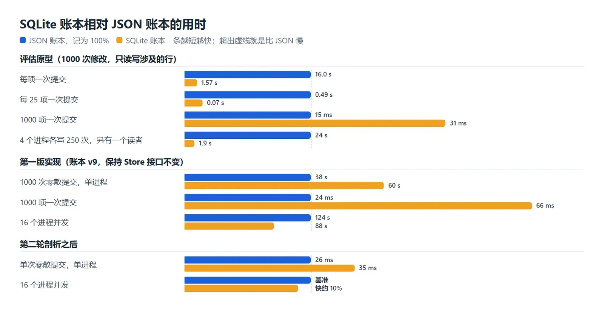

讣告的账本是一个 JSON 文件，记着每一条登记、每一次下葬和待处理的提议。用户会像我们一样同时开十几个 agent，每个 agent 每写一个文件都会拉起一个 hook 进程，每个进程各自提交一小笔改动，而 JSON 账本每次提交都要把整本重写一遍。11 月 9 日我们认真评估过换成 SQLite。这个分支到今天也没有合进主线，账本仍然是 JSON，只是比当时快得多。

## 原型里快了十倍

评估用的是纯 Go 的 SQLite 驱动 modernc.org/sqlite v1.62.0，不依赖 C 编译器，WAL 模式，`synchronous=FULL`，每次提交都真实落盘，测的是 1000 次修改。每项一次提交时，JSON 要 16.0 秒，SQLite 只要 1.57 秒。每 25 项提交一次，是 0.49 秒对 0.07 秒。4 个进程各写 250 次、同时还有一个读者，是约 24 秒对约 1.9 秒。这几种情形都是同时开十几个 agent 时会遇到的，差距也最大。

也有 JSON 占优的情形。1000 项一次提交时，JSON 只要 15 毫秒，SQLite 要 31 毫秒，因为一次提交里 JSON 只写一次文件，SQLite 的事务开销反而更多。

当天下午决定记了下来：用 SQLite，WAL 加 `synchronous=FULL`，`core.Store` 接口不变，账本按行存。代价也写在旁边，`obit.exe` 会大 5.3 MiB，旧账本要迁移，旧版程序要能安全地拒绝新格式，只读诊断不能顺手建出文件。

## 第一版实现比 JSON 还慢

傍晚第一版实现就绪，账本升到 v9：按行存储，从旧 JSON 迁移，旧版程序拒绝读取新格式，只读诊断不建文件，测试全部通过。接着量了一遍，单进程零散提交反而更慢：1000 次提交约 60 秒，JSON 约 38 秒，1000 项一次提交 66 毫秒，JSON 24 毫秒。只有多进程并发时 SQLite 才占优，16 个进程是 88 秒对 124 秒。

原型只读写涉及的那几行。真实实现保持 `Store` 接口不变，每次提交仍然把整本账本读进来、解码，改完再编码。这三步 JSON 也要做，SQLite 只省掉了写文件，又多了一次 WAL 提交，关闭连接时还可能做 checkpoint。第二天的第二轮剖析把这些开销逐项量了一遍，优化之后单进程零散提交一次 35 毫秒，JSON 是 26 毫秒，并发只有 16 个进程时快了大约 10%。

<figure>
  
  <figcaption>同一批场景下 SQLite 相对 JSON 的用时，JSON 记为 100%。原型里的优势在第一版实现里消失，第二轮剖析后只剩并发时的一点点领先。</figcaption>
</figure>

## 先搁置，等常驻进程

同一天傍晚，托盘常驻进程的决定定了下来：开一个很小的后台进程，常驻在系统托盘里。常驻进程可以兼任账本的唯一写入者，长期持有数据库连接，每次打开和关闭连接时的 checkpoint 开销就自然消失。账本整本留在内存里，SQLite 才只需要写变化的行，这时的提速才名副其实。

所以第一轮结果出来后，门槛先放宽了，只剖析、只做便宜而且风险低的改进。第二轮结果出来后，分支留着不合，和常驻进程的单写者一起再合。合并的门槛也写得很具体：单进程零散提交不慢于 JSON，并发比 JSON 快。账本到现在仍然是 JSON。

## 真正有效的做法

第一件事发生在同一天，是批量收割。一次清理一千个到期条目，原来逐项提交，现在一批最多 32 项放在同一个事务里，每一项仍然按原来的办法复核身份，中断由清单恢复。第一轮审查就报了一个 HIGH：批量做完 Git 复查之后才被 `git add` 的文件，仍然会被移走。第二版把复查挪到每一项移动之前，用 Git 索引里的版本做最后一道检查，从最后检查到移动最多约 1.7 毫秒。自动登记的 1000 个条目，清理时间从 108.7 秒降到 14.4 秒。批量只是把提交合并，每一项的检查一道也没有省。

接下来两天是账本本身。11 月 11 日下午，账本升到 v15，改成紧凑写法，相同的父目录链只存一次，一座很满的墓地不会再让 hook 抢不到锁。晚上升到 v16，把每次下葬的操作、来源和卷各存一份，整本小了约四分之一。`obit rm`、`Remove-Item` 和 `git clean` 原来每个路径拿一次账本锁，长长的一串删除会饿死别的会话的 hook，现在和收割共用批量提交，一批最多 32 项或 100 毫秒的工作，批与批之间放开锁，1000 个路径从约 188 秒降到 16 秒，锁最长的一次持有从 240 毫秒降到约 100 毫秒。

11 月 12 日凌晨账本升到 v17。热账本 `store.json` 只放登记、提议、统计这类经常变的内容，下葬记录搬进一份不可变的墓地快照，热账本里只留一个带哈希的引用。墓地变化时先发布快照，再原子替换热账本，热账本的替换是唯一的提交点，快照缺失或哈希对不上就拒绝读取，不会当成一座空墓地。hook 登记一个写入的文件时只需要重写热账本。在 1300 条下葬记录的账本上，这样一次更新从 80 毫秒降到约 14 毫秒，hook 重写的文件缩到原来的七分之一。今天重新跑这个基准，只改热账本的提交是 9.7 毫秒，同时改墓地的提交是 76.4 毫秒。

<figure>
  
  <figcaption>仓库里的基准 BenchmarkStoreLedger 在这台机器上的一次真实运行，每次提交都真实落盘。热账本 126 KB，墓地快照 764 KB，hook 只重写前者。</figcaption>
</figure>
