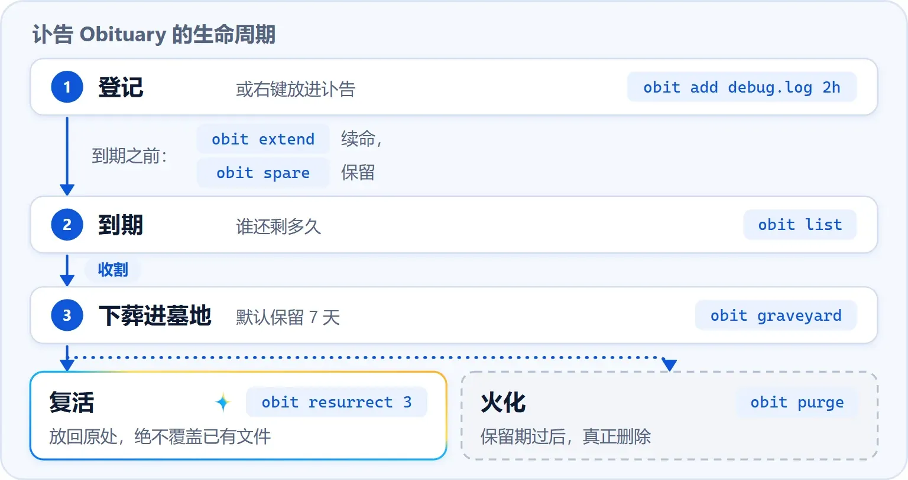

第一版的讣告把到期的东西交给系统回收站，这是最省事的做法，我们在第一个晚上就动手把它换成了自己的墓地。

**讣告现在把一次删除拆成五个动作，每个动作有自己的命令，也只有一个做决定的地方：谁来认身份，谁来移动，谁来真正删除。** 审查的时候，这样才有抓手。

## 一次删除，五个动作：登记、续命、下葬、复活、火化

一个文件的一生是这样的：登记，到期，下葬，在保留期内随时可以复活，过了保留期才火化。

| 说法 | 命令 | 做什么 |
|---|---|---|
| 登记 | `obit mark <路径> <寿命>`（即 `add`），`obit mktemp` | 给路径一个寿命；`mktemp` 直接给出一个会自己过期的临时目录 |
| 续命 | `obit extend` | 推迟到期时间 |
| 饶命 | `obit spare`（即 `cancel`） | 不再跟踪，文件原样留着 |
| 下葬 | `obit bury`，或到期时自动 | 移进墓地，不是删除 |
| 复活 | `obit resurrect` | 放回原来的位置，绝不覆盖 |
| 火化 | `obit purge`，或保留期过后自动 | 真正删除；默认在下葬 7 天后，保留期可以在配置里改 |

<figure>
  
  <figcaption>一个文件的一生：登记之后到期，到期后下葬，保留期内随时可以复活，过了保留期才火化。</figcaption>
</figure>

下面这段输出来自 1.6.0 的代码，在一次性目录里实际跑出来，日期就是写这篇文章的那天，命令行用的是英文界面。第一条命令顺带拉起了一个后台进程，正式安装之后它通常已经在运行。

```text
$ obit mark debug.log 3d
#1 added    C:\Users\Public\obit-demo\debug.log  expires 2026-11-24 15:05 (in 3d)
started a daemon for now; `obit daemon enable` sets up the hidden 5-minute runner that survives restarts

$ obit mark screenshots 1d
#2 added    C:\Users\Public\obit-demo\screenshots  expires 2026-11-22 15:05 (in 1d)

$ obit list
ID  EXPIRES           LEFT  PATH                                   NOTE
#2  2026-11-22 15:05  1d    C:\Users\Public\obit-demo\screenshots
#1  2026-11-24 15:05  3d    C:\Users\Public\obit-demo\debug.log

$ obit bury old-output
#3 buried   C:\Users\Public\obit-demo\old-output  (6 B, restorable until 2026-11-28 15:05)

$ obit graveyard
ID  BURIED            PURGE  SIZE  PATH
#3  2026-11-21 15:05  in 7d  6 B   C:\Users\Public\obit-demo\old-output
pending recovery: 0
```

## 为什么没有一直用回收站：它假设有人在某一刻决定现在就删

交给回收站有它的道理：系统已经有这个东西，用户也熟悉。但它和要解决的问题对不上，原因有四条。

- **回收站假设有人在某个时刻决定现在就删。** agent 留下的调试脚本和截图，当下往往还有用，过两天才变成垃圾，那时会话早就结束了。我们要的是文件在被创建的那一刻就带着寿命。
- agent 自己的删除也不经过回收站。`rm -rf`、`git clean -fdx`、`Remove-Item` 都是直接删除，回收站里什么也没有，WSL、Linux 服务器和容器里本来就没有 Windows 的回收站。
- 东西交给回收站之后，就脱离了我们的管理。回收站不记录是哪个 agent、哪次会话、哪个项目放进去的，它有自己的容量规则，东西能待多久、会不会被直接销毁都不由我们决定。系统的文件操作接口里甚至专门有一个标志，`FOF_WANTNUKEWARNING`（见[官方文档](https://learn.microsoft.com/en-us/windows/win32/api/shellapi/ns-shellapi-shfileopstructw)），用来在文件将被永久销毁而不是回收时发出警告。
- 讣告没办法替 agent 把东西放回去，配置成回收站模式时，`obit resurrect` 就做不到这一点。从回收站还原基本只能在图形界面里点，而 agent 删错了东西，需要的是一条命令，把东西按原样放回原来的位置。

### 还有一个更根本的原因：让 AI 事后判断哪些是垃圾，风险最大

猜错了，删掉的就是没提交的代码。所以在当时的设计里，这件事靠硬规则，不靠判断：

- 被 Git 跟踪的文件永远不会被自动登记，没有开关。
- 一个项目里第一次自动处理，要先问你。
- 到期下葬之前，再问一次 Git。

agent 忘了登记怎么办？会话开始和结束时各拍一张快照，比对出这次会话里多出来的东西。规则认得的（比如 `test-results/`、`*.log`）登记寿命，规则认不得的只变成一条提议，因为新出现的、没被 Git 跟踪的文件，可能是还没提交的代码。

这套自动登记后来改过两次，遗留物的提议被收窄，最后整个改成了默认关闭，细节放在后面的文章里。

每条记录还带着来源、项目和会话，谁在哪次会话里生成了什么，随时能查，`obit stats` 会告诉你埋了多少、腾出多少空间、复活过几次。

## 墓地怎样保证放回去的正是拿走的那个

**下葬先打开对象，核对它的身份，再在同一个句柄上把它改名、移进坟墓。**

### 墓地放在哪里，坟里是什么样

墓地的位置遵循一条规则：

- 数据目录所在的盘，墓地放在数据目录下的 `graveyard`。
- 其他盘放在盘根目录下一个隐藏的 `.obituary\graveyard` 里。

这样下葬永远发生在同一块盘内，只是一次改名，速度快，也不会出现复制到一半的状态。墓地不放在项目里，因为 `git clean -fdx` 会把它一起清掉。

每座坟是一个独立的目录，名字由编号、UTC 时间和六位随机字符组成，里面是原样的对象。上面下葬的 `old-output`，在墓地里长这样：

```text
graveyard/
└── 3-20261121T070527Z-376905/
    └── old-output/
        └── report.txt
```

### 核对和移动用同一个句柄

难点是保证拿走的就是登记的那一个。身份是卷序列号加 128 位文件 ID，以及类型、链接数等。

如果核对和移动是两步，先查路径再按路径改名，中间就有一个窗口，编辑器恰好在这时把文件换成了新的，被移走的就是那个新文件。用同一个句柄，这个窗口就不存在。

### 移动之前先写清单，不确定就不动

移动之前，先在墓地根下写一份小清单，记着编号、原路径、对象和坟墓的身份、原因和来源。进程如果在移动和账本提交之间崩了，下葬做到一半的状态就只存在于这份清单里。下一次运行先读清单：

- 坟墓里正好是清单说的那个对象：补记。
- 坟墓是空的：清掉清单。
- 其他情况：一律不动，只记日志，`obit doctor` 会给出警告。

**不确定就不动，是整个设计的底线。**

真正的移动发生在一次账本写锁里。锁内再确认这条记录没被改过、仍然到期、目录里没有寿命更长的子条目，自动登记的还要再问一遍规则和 Git，任何一项不过就不移动。

做自己的墓地，就得自己实现清单、恢复和火化的全部崩溃安全逻辑，接下来几天的审查轮次大部分花在这里。换来的是，agent 删错了东西，从一次事故变成了一条命令能解决的事。

## 复活绝不覆盖，永久删除只有火化一处

复活把东西放回它下葬时的路径。原路径已经被别的东西占了，就在名字后面加上后缀并告诉你，绝不覆盖。下面重新建了一个同名的 `old-output`，复活出来的那份就叫 `old-output (resurrected)`，两份并存：

```text
$ mkdir old-output

$ obit resurrect 3
#3 resurrected  C:\Users\Public\obit-demo\old-output (resurrected)

$ ls -1
debug.log
old-output
old-output (resurrected)
screenshots
```

### 复活比下葬更容易出错，因为原来的环境可能已经变了

下葬时我们记下了从原位置到卷根的每一级祖先，复活前逐级核对：

- 其中某一级在下葬之后被换成了链接（junction、符号链接、挂载点），就拒绝，否则东西可能被放到完全不同的地方。
- 缺失的目录会重建，复活最终被拒绝时，本次新建的目录也会撤销。
- 重名由改名这一步本身来判定，而不是先探测名字有没有人用、再去改名，后者在探测和改名之间又留了一个窗口。

### 到期不需要人在场

给一个文件设 3 秒的寿命，等几秒钟，常驻的后台进程就会把它下葬。上面的 #3 已经复活，所以墓地里只剩这一项：

```text
$ obit mark scratch.txt 3s
#4 added    C:\Users\Public\obit-demo\scratch.txt  expires 2026-11-21 15:05 (in 3s)

$ obit graveyard
ID  BURIED            PURGE  SIZE  PATH
#4  2026-11-21 15:05  in 7d  7 B   C:\Users\Public\obit-demo\scratch.txt
pending recovery: 0
```

### 火化：整个代码库里唯一永久删除用户内容的地方

**整个代码库里，真正永久删除用户内容的地方只有火化（`purge`），而且它只处理通过核实的坟墓：是登记过的那一座，里面只有一项，身份对得上。**

收割和下葬对用户的东西只做移动。提前火化要由人点头：

- `obit purge --all`，或者按编号、按路径指定，都会越过保留期，所以命令先列出要火化的东西，再问一次 `[y/N]`。
- 不是终端的时候直接拒绝，除非加 `--yes`，报错还会写明 agent 要先问用户。
- MCP 里没有火化这个工具。

不可撤销的决定，都留给人。

<figure>
  
  <figcaption>窗口里的墓地页（示例数据）：每座坟排在它将被火化的那一天，选中卡片后可以复活，也可以提前火化。</figcaption>
</figure>

## 回收站更合适的场合：人手动删一个文件

人手动删一个文件，回收站完全够用，讣告不去抢它的位置。

需要的话，可以在配置里切成回收站模式，到期的东西直接送进系统回收站，代价前面说过：`obit resurrect` 复活不了它们。另外，系统是在我们核对身份之后按路径回收的，中间有几毫秒的窗口，路径恰好在这时被换成另一个文件的话，进回收站的就是那个文件，它仍然可以在回收站里还原。

讣告的价值取决于 agent 产生了多少碎屑。一天只让 agent 改两三个文件的人，感觉不会明显；天天让 agent 跑测试、截图、写调试脚本的人，收益最大。

让 agent 在创建文件时登记寿命，要靠 agent 配合，所以我们给各家 agent 装 hook、Skill 和说明文件。
