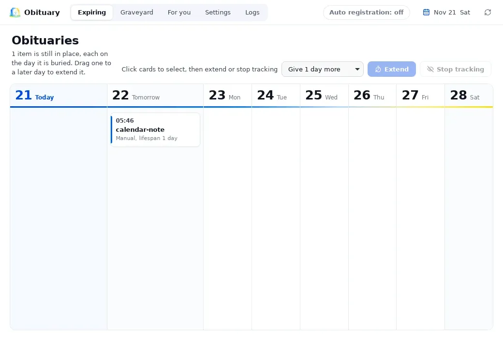
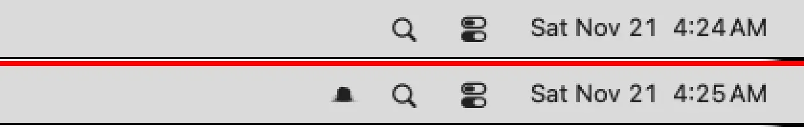
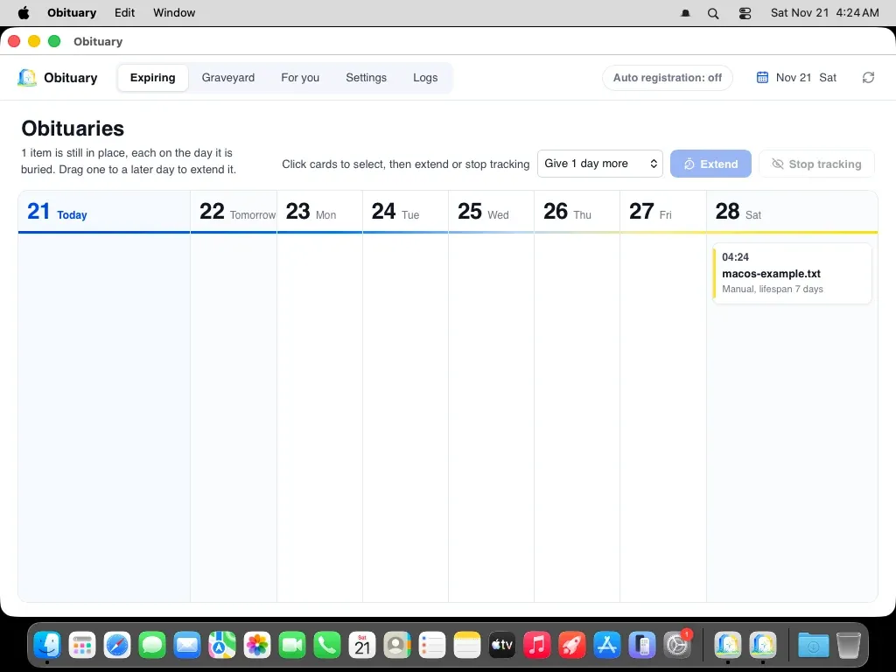
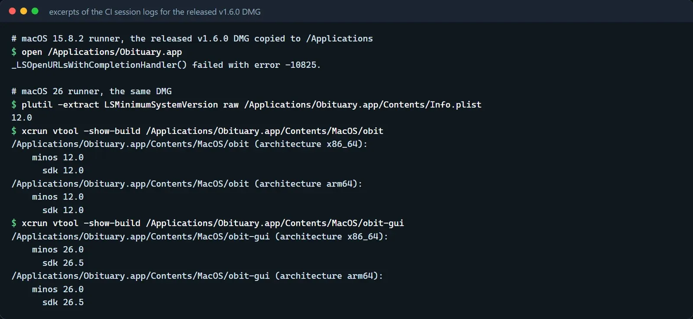
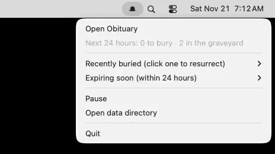

1.6.0 在 11 月 21 日中午发布，带上了 Linux 和 macOS 的小窗口，两个桌面包都标为预览。从凌晨 3 点 01 分第一次提交 Linux 窗口的代码，到下午 1 点 22 分发布，十个多小时。

**这段时间里最难的一个问题是：没有 Mac，怎么知道菜单栏里真的出现了那个图标。**

## 复用同一个窗口：Wails 前端不变，窗口和托盘仍是两个进程

Windows 上已经有 Wails 的前端和命令行的定时后台。再为 Linux 和 macOS 各写一套界面，既费力，也容易让同一个设置在三个平台上有三种行为，所以决定复用。窗口和托盘仍然分成两个进程，复用 Wails v2、systray 和现有的前端。

分两期发布：

- 第一期：Ubuntu 24.04 amd64 的 `.deb`，没有托盘宿主的桌面也能从应用列表里打开窗口。
- 第二期：一个通用的 DMG，里面的 app 同时支持 Intel 和 Apple 芯片。

1.6.0 是正式的 Release，两个桌面包标为预览，原来的六个归档不动。右键菜单和回收站分别验收。代价写在决定里：

- Linux 的其他发行版和架构不在这次承诺之内。
- Mac 的包没有经过 Developer ID 签名和公证，所以文档里要写明第一次怎么放行。

## Linux：私有的显示和总线，整个流程能在 CI 里跑完

验证脚本用一个私有的 Xvfb 显示、私有的会话总线和临时的用户目录，检查窗口、托盘、复活和通知，不碰宿主的显示器。窗口用的是和 Windows 同一套前端，凌晨 3 点补上了托盘、XDG 自启动，Linux 上没有意义的设置项被隐藏，托盘宿主缺失时进程不会退出。`.deb` 的打包和校验在 5 点 49 分合进来。

<figure>
  
  <figcaption>在 Linux 上运行的小窗口，和 Windows 上是同一套前端。截图来自私有的 Xvfb 显示，界面是英文。</figcaption>
</figure>

## macOS：没有 Mac，靠前后对比验菜单栏图标

macOS 的窗口只能在 GitHub Actions 的 macOS runner 上构建和验收。上午 7 点 47 分第一次提交 macOS 的 app 和托盘，之后的十几个提交在把打包和验证一步步修通：runner 的选择，链接 UniformTypeIdentifiers，zip 要从 app 的父目录创建，校验和要在包所在的目录里核对，最后 app 是通过 DMG 发布的。

Actions 里跑的是 `plutil`、`lipo`、ad-hoc 的 `codesign`、`hdiutil`，还有 app 里的 `--smoke`，并且上传窗口和菜单栏的截图。

### 菜单栏图标：只有进程存在、日志写着 ready、一张裁出来的图，都不能证明用户看得到

所以验收的做法是对比：

1. 在原生 runner 上检查包、架构、签名和启动。
2. 停掉所有的托盘进程，对同一块菜单栏区域截一张没有图标的图。
3. 再重启，截一张有图标的图，同时留下前后的 readiness 和进程列表。

最后一个提交，是在截无图标的那一张之前，先把所有的托盘进程都停掉。**最后一次对照里，搜索图标的左边重新出现了墓碑。**

<figure>
  
  <figcaption>在 macOS runner 上截的菜单栏同一块区域。上面是停掉所有托盘进程之后，下面是重启之后，搜索图标左边多了墓碑。</figcaption>
</figure>

<figure>
  
  <figcaption>在 macOS runner 上运行的小窗口，来自同一轮取证。界面是英文。</figcaption>
</figure>

这样的证据有边界。它是 CI 图形会话里的证据，不能代替真机上的第一次放行、深浅色、登录启动、通知授权和卸载，这几项单独列进了真机清单。

## 发布之后的第一次验收：macOS 15 上打不开，原因是最低系统版本

1.6.0 发布之后，同一天下午，我们在 GitHub 的 macOS runner 上验收了已经发布的 DMG，没有从分支重新构建，用的就是 Release 里的那个文件，Apple 芯片和 Intel 各一台，系统是 macOS 15 和 macOS 26。验收的过程没有清除隔离属性，没有关闭 Gatekeeper，也没有替用户批准系统提示。

### macOS 26：结果是好的

- 从 `/Applications` 冷启动，重复打开时只保留一个进程。
- 托盘菜单里的 Open Obituary 能打开有数据的日历窗口。
- 系统在浅色和深色之间切换时，菜单栏和窗口标题栏跟着变化，窗口内容保持浅色。
- 移除 app 之后，用户数据目录里的账本、配置和墓地记录的 SHA-256 全部一致。

### macOS 15：两台都打不开

校验 DMG，把 app 复制到 `/Applications`，弹出卷，再 `open`，系统返回错误 -10825，没有出现窗口。

**原因是构建时没有设置最低系统版本：程序实际要求 macOS 26，`Info.plist` 里却写着 12.0。**

对 app 里每个可执行文件运行 `vtool -show-build`：

| 可执行文件 | 最低系统版本 | SDK |
|---|---|---|
| GUI（两个架构切片） | 26.0 | 26.5 |
| `obitd`（两个架构切片） | 26.0 | 26.5 |
| 命令行 `obit` | 12.0 | |
| `Info.plist` 的 `LSMinimumSystemVersion` | 12.0 | |

<figure>
  
  <figcaption>CI 会话日志里的几段原文，没有改动，只省略了无关的行。DMG 里的二进制和 Info.plist 的声明对不上。</figcaption>
</figure>

### 验收还发现了几件别的事

- 第一次打开之后菜单栏里没有出现图标，要手动启动 app 里的 `obitd --tray`，图标和菜单才出现。
- 日历为空的提示里写的是用 Windows 资源管理器的右键菜单，这在 macOS 上不适用。
- 通知请求在 runner 上返回了错误，没有迹象表明是用户拒绝，要在真实的用户环境里判断是不是 runner 的限制。
- 文档里没有列出移除 DMG 安装之后保留的具体路径。
- 通过设置开启登录启动，在 CI 里没有生成 LaunchAgent 的 plist，也无法确认物理点击是否生效。
- arm64 的最后一次运行里，卸载之前找不到先埋下的那份保留样本，现有的证据说明不了是丢了、被误复活，还是卸载造成的，所以这一轮不算第三次通过，Intel 在最后一次运行里再次保留成功。

<figure>
  
  <figcaption>macOS 26 上验收时的托盘菜单。</figcaption>
</figure>

## 已经做的，和还没做的：1.6.1 当晚发布

这个问题在 1.6.0 的 GitHub 发布说明里已经写成已知问题：这一版 macOS 的小窗口需要 macOS 26，在 macOS 15 及更早的系统上打不开，1.6.1 修复。

修复在下午 4 点 16 分合进了 main：

- CI 里强制检查部署目标，部署目标定为 12，发布之前对同一个 DMG 再验证一遍。
- 第一次打开时由窗口启动常驻进程。
- 菜单行被移除时不再派发点击，也就是验收里复现的幽灵点击。
- 菜单栏的辅助进程有了自己的通知身份。
- 文档补上保留数据的路径和发布前的 DMG 检查。

**1.6.1 在傍晚 6 点 16 分发布。**

发布之前，这套验收先用候选的 DMG 在 macOS 15 和 macOS 26、Apple 芯片和 Intel 上各跑了一遍，Gatekeeper 线和桌面线共 8 个任务全部通过。发布之后，又对 Release 里的那个文件（没有重新构建）跑了一遍，8 个任务在 6 点 19 分同样全部通过。在 macOS 15 上，桌面线里的冷启动、托盘进程、菜单栏图标和重复打开只保留一个进程这几项都通过了，1.6.0 在这里返回错误 -10825 的问题没有再出现。

### 还要真机来做的四件事

1. 用 macOS 26 和浏览器下载发布的 DMG，在系统提示和隐私与安全性里实际点仍要打开，确认重新打开不再要求放行。
2. 手动打开设置里的登录启动，核对 plist 和服务，再关掉确认它们消失。
3. 在两个干净的用户环境里分别选通知的允许和拒绝。
4. 在 Apple 芯片上把保留一份、复活一份的场景再核对一遍，样本都用一次性文件。

这份清单定在 11 月 23 日。
