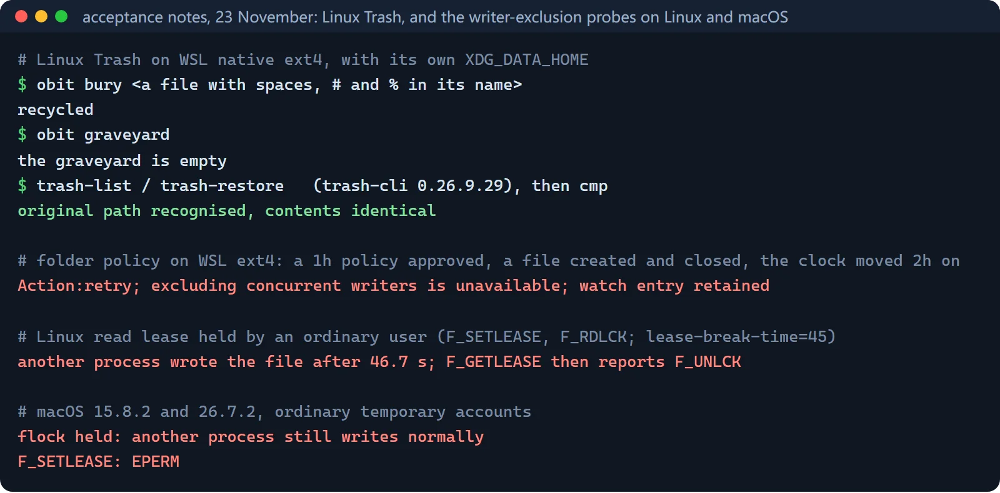

Linux 的回收站模式做成了，文件夹策略在 macOS 和 Linux 上能设了，但到期的文件不会自动下葬。后者卡在一个 Windows 上能做到、这两个系统上做不到的保证。

**下葬之前，必须保证没有别的程序正在写这个文件。Windows 能用独占打开做到，macOS 和 Linux 实测做不到。**

## Linux 回收站：按规范放进去，桌面工具能原样还原

`graveyard.mode = recycle` 在 Windows 之外，现在 Linux 也能用。被下葬的东西进系统自带的回收站，用桌面工具还原，不进讣告自己的墓地。

按 freedesktop 的回收站规范，我们做了这些：

- 文件放进 `files/`，信息写进 `info/*.trashinfo`，目录是私有的 0700。原路径做 URL 转义，删除日期取本地时间。
- 用 mount ID 区分设备号相同的不同挂载。其他卷优先用共享的 `.Trash/<uid>`，没有就用私有的 `.Trash-<uid>`。
- 先在系统可以清空的 `files/` 之外暂存并核验，再发布。发布和回滚都用同卷、固定父目录、不覆盖的移动，并核验身份。
- **失败时不复制，不永久删除。**

### 验收：独立的回收站客户端能还原，字节一致

在 WSL 的 `/tmp` 里用独立的数据目录、配置目录和 `XDG_DATA_HOME` 验收：

- `obit bury` 对一个名字里有空格、`#` 和 `%` 的文件输出 `recycled`，`obit graveyard` 输出 `the graveyard is empty`。独立的 `trash-list`、`trash-restore`（trash-cli 0.26.9.29）认得原路径，还原后 `cmp` 逐字节相同。
- 另一个卷：用 `unshare -Urnm` 建一个私有的 tmpfs 挂载，`.Trash-0/info/*.trashinfo` 里的 `Path=volume-file` 是相对路径，用 `trash-restore --trash-dir` 指定后恢复，`cmp` 通过。这个客户端不会自动枚举测试用的 tmpfs，所以显式指定了回收站，没有用真实的外置磁盘。
- 绑定挂载：修复之前得到 `invalid cross-device link`，原文件仍在；修复后同设备号的挂载会在本挂载里建 `.Trash-0`，内容一致。

<figure>
  
  <figcaption>11 月 23 日验收记录的摘录。上半是 Linux 回收站的还原，下半是文件夹策略到期时没法排除并发写入者，以及我们试过的两种锁在 Linux 和 macOS 上为什么都不行。</figcaption>
</figure>

### 安全失败：三个测试各守一道

- `TestRecycleLinuxDesktopEntry`：实现之前报 `operation is not supported`，实现之后两个同名条目都保留，编码和日期都能读出来。
- `TestRecycleLinuxRejectsRedirectedTrash`：回收站目录被重定向时，源文件保住，链接的目标没有被写入。
- `TestRecycleLinuxPublishFailureRestoresSource`：发布失败之后，原文件内容完整。

把禁掉回滚的变异体编译出来（不是编译失败），目标测试因为源文件 `no such file or directory` 而真的失败。

### 恢复的边界

Linux 系统回收站由桌面工具负责还原，不会生成讣告的墓地条目。**系统清空回收站之后，不能再用 `obit resurrect` 找回。** 进程中断或失败可能留下没有内容的 `.trashinfo`；遇到无法回滚的冲突，会保留暂存的东西，需要按错误信息里的路径手工检查，不会强行删除。

## macOS 的废纸篓暂不开放：目录里有，不等于 Finder 能放回原处

我们在 macOS 15.8.2 和 26.7.2 的一次性系统用户下试了两种方式：`/usr/bin/trash` 和直接 `mv`。两者都能把文件送进这个账号的 `.Trash`，在只读的源目录上失败时原物仍在。

问题在于这个隔离账号没有 Finder 的图形会话。**文件在废纸篓目录里，不等于 Finder 看得到，更不等于"放回原处"能成功。** 我们没法确认，所以 macOS 不启用回收站模式，也不用手工 `mv` 回去来冒充系统的恢复。文档里 macOS 仍然是只有墓地。

## 文件夹策略：macOS 和 Linux 也能设，到期的文件却不下葬

"下载"这类文件夹策略，是给文件夹设一个寿命，里面新出现的文件从讣告第一次看到它算起，到期下葬。这一天 macOS 和 Linux 也能设了。

事件和补账用的是现有的实现：fsnotify、不递归的监听，加每 5 分钟一次的全量对账，不需要引入 FSEvents、CGO 或新依赖。测试覆盖了几条规则：

- 把对账间隔设成一小时，策略变化和新文件也照样被发现，离线期间到达的文件会补上。
- 第一次看到的文件需要先批准；子目录只提议，不直接下葬；下载中的临时文件（`.crdownload`）不登记，改成正式名字后从第一次发现算起重新计 2 小时。
- 已有的上层目录寿命不能把策略目录本身下葬。

验收还找到一个真实的入口缺口：原来的 POSIX 命令行用例特意绕开了 `~/Downloads`，用的是 `Downloads/inbox`。改成真正的 `~/Downloads` 后得到 `it is or contains a protected folder`。复用现有的 `WatchAllowed` 之后用例通过，而 `Guard.Check(downloads, true)` 仍然拒绝，也就是说策略可以设，删除护栏没有松开。Linux 回收站和这个入口修复都在 11 月 23 日 17:23 合进 main。

### 没通过的一条：安静、已关闭、到期的文件，没法自动下葬

我们在 WSL 的原生 ext4 上做独立验收：批准一个 `1h` 的策略，创建并关闭一个普通文件，对账，把业务时钟推进 2 小时。期望是 `buried`，实际是：

```text
Action:retry; excluding concurrent writers is unavailable; watch entry retained
```

**这是 `internal/winfs/watch_unix.go` 的有意拒绝，保护的是一条契约：从开始观察到释放，其他写入者始终被排除。** 要在 Linux 和 macOS 上满足它，我们试了现成的两种机制，都不行：

- **Linux 的读租约。** 普通用户申请 `F_SETLEASE` 加 `F_RDLCK` 并一直持有文件描述符。在默认 `lease-break-time=45` 的 WSL 上，另一个进程的写入在 46.7 秒之后成功，`F_GETLEASE` 变成 `F_UNLCK`。我们没有改 sysctl。
- **macOS 的锁。** 在 15.8.2 和 26.7.2 的临时普通账号上，持有 `flock` 时其他进程仍能普通写入；申请 Darwin 的 `F_SETLEASE` 都返回 `EPERM`。

这是对这些候选机制的否证，不等于证明这两个平台上不存在任何解法。

所以现在 macOS 和 Linux 上文件夹策略里的文件，到期之后只会一直留在原处，批准一个已到期的子目录也不会移动它。手动 `obit bury` 不受影响，文档里也写明了这一点。

### 已经定下的下一步，还没有做

到期以后我们想做成一个可选的设置：默认到期之后再静置 10 分钟，查不到有程序开着这个文件，才自动下葬；另一个选项是变成一条提议，批准之后才下葬。文档里会写清楚，macOS 和 Linux 没法像 Windows 那样保证没有别的程序正在写。这一项排在后面，现在的版本还是到期不动。

## 没有测到的

macOS 的 Finder 实屏、系统的"放回原处"、桌面通知有没有真的弹出来，以及写入排除还不成立的 POSIX 自动下葬。macOS 一侧的结果来自 GitHub 的一次性机器，没有在我们自己的 Mac 上跑。
