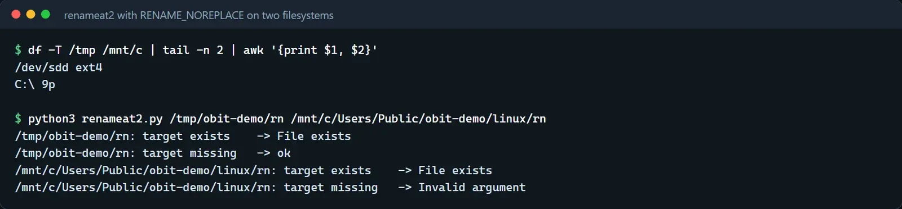
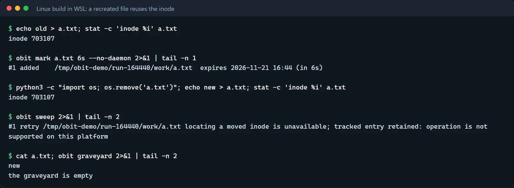

下葬在 Windows 上做的是一件很具体的事：打开文件，在同一个句柄上核对它的身份，再在这个句柄上改名。核对和改名之间文件没有机会被换掉。macOS 和 Linux 没有这样的系统调用，`rename`、`renameat2` 和 `renameatx_np` 都只认父目录加名字。核对之后、改名之前，编辑器如果换了一个新文件，被移走的就是这个新文件。

## 先不放宽

11 月 10 日我们的决定是不放宽承诺。`core.FS` 对下葬的要求是核对后原子移动，做不到这一点的平台，需要它的操作就明确返回不支持，条目保留，不下葬。另一种做法是先用 `/proc/self/fd` 把核对过的 inode 硬链接进墓地，再按名字移走、核对、不对就挪回，对文件能把窗口压得很小，冲突时被换进来的文件可能暂时留在隔离目录里等人放回，对目录则完全做不到。我们没有采用。

这个决定的代价写得很清楚：在 macOS 和 Linux 上暂时只能登记、查看和用 hook，下葬、复活和进回收站都返回这个平台暂不支持，到期的东西不会被清理。

## 先移再核对

两天后这条界线挪了。没有下葬和复活，这两个平台上等于用不了核心功能，而很多用户用的是 Mac。11 月 12 日我们要求快速适配 macOS 和 Linux，办法是先移，再核对，不对就放回。

具体是这样。固定住源和目标的父目录，用不覆盖的改名把对象移过去，Linux 用 `renameat2` 的 `RENAME_NOREPLACE`，macOS 用 `renameatx_np` 的 `RENAME_EXCL`。源对象另外用 `openat` 固定成一个文件描述符，Linux 是 `O_PATH`，macOS 是 `O_EVTONLY`，整个过程保持打开，移动期间这个 inode 不会被释放再被复用。移完之后立刻在新位置核对设备号、inode、类型和链接数。核对不符，就用同样的不覆盖改名放回原处，返回一个可以重试的错误。放不回去，也就是原位置已经被占了，对象就留在墓地，墓地记录标成身份不符，永远不火化，`obit graveyard` 和 `obit doctor` 会显示它在哪里，怎么人工处理。

有些文件系统连不覆盖改名都不支持。下面是在 WSL 的 Ubuntu 里做的一个小实验：同一个 `RENAME_NOREPLACE`，在 ext4 上目标不存在就成功，目标已存在就报文件已存在，在 `/mnt/c` 上，也就是 Windows 磁盘通过 9p 挂进来的那个位置，目标不存在时返回的是无效参数。碰到这样的文件系统，讣告返回不支持，不退回到普通的 `rename`。

<figure>
  
  <figcaption>同一个不覆盖改名在两种文件系统上的真实结果。ext4 支持，9p 返回无效参数，所以在这类位置上讣告拒绝下葬。</figcaption>
</figure>

比 Windows 弱的地方也写在决定里。核对和改名之间如果恰好被编辑器换成了新文件，这个新文件会被短暂地移走再放回，或者留在墓地等人处理，不会被删除。

## 同一个路径上换了一个文件

身份核对在 POSIX 上还有一个 Windows 上没有的问题：inode 会被复用。Linux 上删掉一个文件再在同一个路径上重新建一个，新文件常常拿到同一个 inode，几天前登记的条目就会把新来的文件当成旧文件。11 月 12 日傍晚的修复给文件 ID 的高 8 字节加了一个创建标识。Linux 上它是导出文件句柄的哈希，句柄里带着 inode 的 generation，再加上 `statx` 的创建时间，macOS 上是创建时间。拿不到这个标识的文件系统，比如没有开 `nfs_export` 的 overlayfs，拒绝登记寿命，立即执行的 `bury` 仍然可以，因为它固定了文件描述符。旧账本里只有 inode 的条目到期时保留，`list` 和 `doctor` 会提示重新 `obit mark`。

下面在 WSL 的 ext4 上用 Linux 版重现了这件事。删掉重建之后，新文件拿到了一模一样的 inode 编号，到期的清理没有把它下葬，条目被保留，之后重试。

<figure>
  
  <figcaption>在 WSL 的 ext4 上真实运行 Linux 版：删除再重建的文件拿到了同一个 inode，讣告没有把新文件当成旧文件下葬。</figcaption>
</figure>

## 整套测试搬到两个平台

当天晚上 8 点 58 分，整套测试在 Linux 和 macOS 上跑了起来，CI 里的两个任务运行 `go test ./...`，加上原生的安全变异检查，今天 Linux 上的那个任务还带着 `-race`。固定装置里的盘符、junction、假 Docker 和临时目录都改成两边都成立的写法。Windows 独有的行为，比如备用数据流、扩展路径、注册表、资源管理器和快捷方式，在 POSIX 上带着理由跳过，POSIX 缺少某种能力的地方，比如整卷按 inode 查找，测试断言的是保守的结果。

搬测试的过程发现了几处产品问题，Windows 的行为没有变。删除护栏把每个 POSIX 的当前目录都当成 WSL 互操作，所以原生的 Linux 和 macOS shell 里的删除没有被拦。卸载走 `obitd`，并跳过 Run 键、资源管理器和右键菜单。登记和观察改成检查已知的已跟踪路径，不再因为不支持整卷查找而失败。名字里带冒号的文件可以复活了。晚上 10 点 15 分，第一轮 CI 又修了一批，大多是 macOS 的习惯：不区分大小写的 APFS，`~/Library/Application Support`，以及 `/var` 下面被解析过的临时目录。

11 月 13 日中午 12 点 02 分合并，12 点 17 分发布 1.1.0。macOS 上用 launchd，Linux 上用 systemd 的用户定时器检查到期的文件，macOS 可以用 Homebrew 的 cask 安装，两个平台都可以用核对 SHA-256 的安装脚本，装到 `~/.local/bin`，删除护栏在这两个平台的终端里同样拦下 `rm -rf`。
