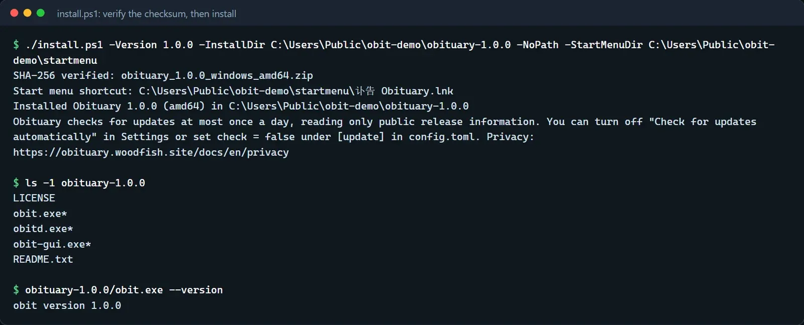
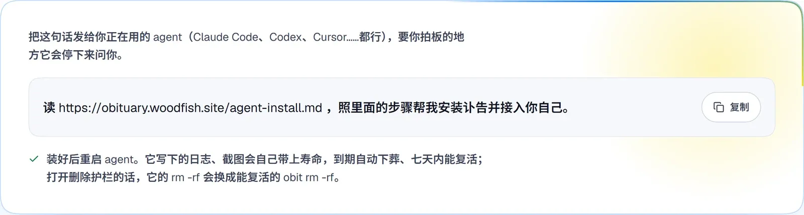

**讣告 1.0.0 在 11 月 11 日晚上 7 点 50 分发布，离 11 月 7 日夜里的第一个提交不到四天。**

这一版是 Windows 上的全套体验，安装包有 amd64 和 arm64 两个，另有一份 `checksums.txt`。

## 第一个版本叫 1.0.0，先只做 Windows

计划里的第一个版本原来叫 v0.1。11 月 10 日晚上 8 点 43 分，我们定了先把 Windows 的全套体验做完就发布，macOS 和 Linux 的桌面集成放到后面。

- 那时 Windows 上的小窗口、托盘、右键菜单、资源管理器里的日期、文件夹策略和安装渠道都已经接近可以发布。
- macOS 和 Linux 的平台层只做到一部分，右键菜单、文件夹监视、通知和文件管理器标签还没有开始。
- 核心包的拆分也推迟到发布之后，免得大规模的机械改动和发布前的修复互相冲突。

**代价是 1.0.0 的 macOS 和 Linux 用户只能自己编译，试用其中一部分功能。**

晚上 10 点 47 分，第一个版本从 v0.1 改名为 1.0.0。

## 安装包和渠道：只有 `v*` 标签才会触发，安装前先核对 SHA-256

发布用 goreleaser，11 月 10 日傍晚配好：

- 为 Windows 的 amd64 和 arm64 构建 `obit.exe` 和 `obitd.exe`，amd64 另有 `obit-gui.exe`，连同 README 和 LICENSE 打成 zip，再写出 SHA-256 校验和。
- 只有 `v*` 标签才会触发发布流程，而且只建一个草稿 release，上传 zip 和校验和，不碰任何渠道，发布说明手写完才公开。
- 同一个傍晚还写了 Scoop 和 winget 的清单，winget 用的是便携 zip，以及安装脚本 `install.ps1`。

### `install.ps1` 的行为

- 先下载压缩包和 `checksums.txt`，两者永远来自同一个地方，然后核对 SHA-256，不一致就拒绝解压，没有绕过这个检查的开关。
- 默认装到 `%LOCALAPPDATA%\Programs\obituary`，把这个目录加进用户的 PATH。
- 支持 `-WhatIf`，重复运行也不会出问题。
- 持续集成会拿构建出来的快照清单把安装脚本跑一遍，并且不改 PATH。

下面是用发布出去的 1.0.0 真实跑一遍的结果，装进一个临时的演示目录。

<figure>
  
  <figcaption>用已发布的安装脚本安装 1.0.0 的真实输出，装进临时的演示目录。校验和核对通过才解压，压缩包里是三个程序加许可证和说明。</figcaption>
</figure>

winget 要把清单提交到微软的仓库审核，要几天。审核期间，给 agent 看的安装步骤里不列 winget，因为 agent 遇到报错会停下来，给人看的文档里写的是审核中。

## 第一句话发给 agent

讣告是给 agent 用的，所以安装它的第一步也交给 agent。11 月 11 日凌晨写了一段提示：读 `agent-install.md`，照里面的步骤安装讣告并接入你自己。

agent 会装好程序，运行 `obit init` 把 hook、规则和 Skill 接到自己身上，遇到要用户拍板的地方停下来问。

下午三点半，README 的安装部分换成了这一句话和一面 agent 墙，手动安装的各种办法，包括 Scoop、winget、脚本、国内镜像、手动接入、检查、更新和卸载，搬进了 `docs/install`，同时有英文版。

<figure>
  
  <figcaption>官网安装区里发给 agent 的那句话，旁边有复制按钮。agent 读完文档会自己装好并接入，需要用户决定的地方它会停下来问。</figcaption>
</figure>

## 最后一夜，和 1.0.1：不到五个小时之后

11 月 11 日凌晨到上午，几轮自己用着找问题。这一夜改的东西：

- 墓地提醒加进来，agent 碰到已经下葬的路径时会当场被告知。
- Docker 容器也有了寿命。
- 会话开头的到期清单改成默认关闭。
- 窗口里的用词逐页改过一遍，比如容器写成 Docker 容器，不再显示 0 B，即将到期改叫即将下葬。

发布前还有一份真机验收清单，大约 30 到 40 分钟，在新建的练习仓库里把 Claude Code 和 Codex 的流程走一遍。开发中的 agent 和 worker 不许碰真实的 `~/.claude`、`~/.codex` 和注册表，所以真实宿主里的表现只能由人来验。

### 11 日晚上的发布节奏

- 发布前要把完整测试和变异测试各跑一遍。变异测试串行要二十多分钟，下午 7 点 18 分改成按编号拆到 8 台机器并行。
- 7 点 33 分打上 v1.0.0 标签。
- 7 点 50 分发布。

### 1.0.1：用 Go 1.26.11 重新构建

Go 官方在 11 月 10 日发布了 1.26.11，发布说明写着它带有 cgo、`go` 命令、编译器、链接器和 `net/http` 的安全修复。讣告不依赖 cgo，标准库编译进了可执行文件，标准库的修复只有重新构建才能进到安装包里。

所以发布当晚我们用 1.26.11 重新构建，把依赖更新到当时的版本，11 月 12 日 0 点 22 分打上 v1.0.1 标签，0 点 38 分发布。

**从 11 月 11 日到 21 日，一共发了 15 个版本，含 1.0.0。**
