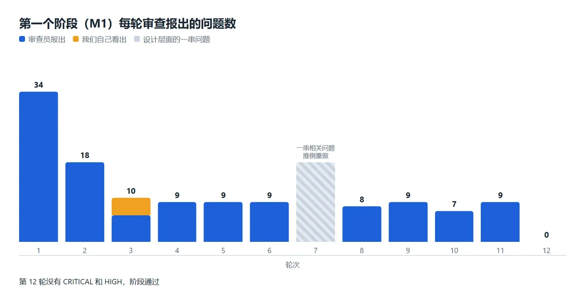
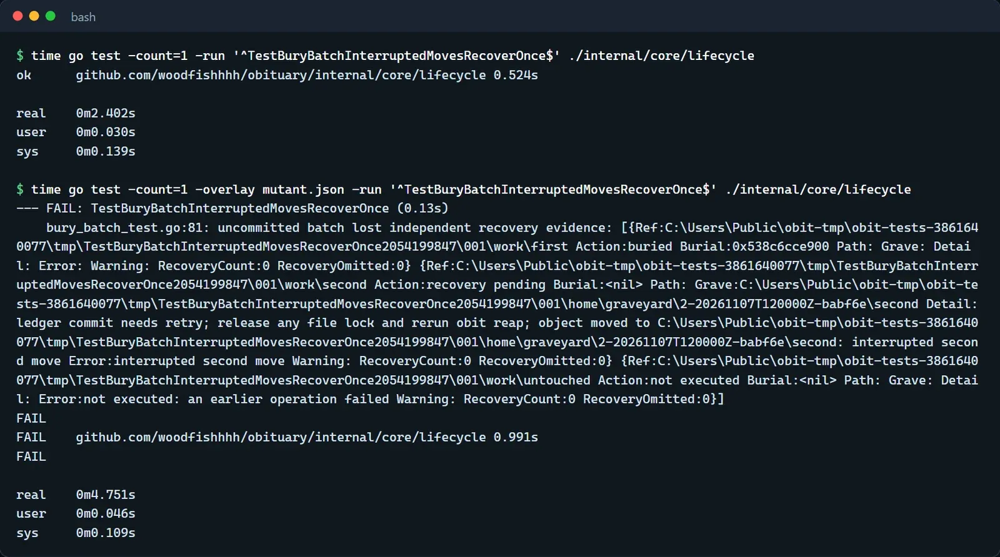

11 月 8 日这一天，讣告的三个阶段一共审了 40 轮。凌晨一点到早上七点审第一个阶段，共 12 轮；上午审删除护栏，10 轮；下午一直审到第二天清早，18 轮，审的是 MCP 服务和 Skill。办法是第一个晚上定下的写、审、修循环，这一天它被用到了极致。

| 阶段 | 内容 | 轮数 | 起止（11 月 8 日起） |
|---|---|---|---|
| M1 | 自动登记、墓地、与 Claude Code 和 Codex 的接入、后台运行器 | 12 | 约 01:00 到 07:00 |
| M2a | 删除护栏 | 10 | 约 07:55 到 12:35 |
| M2b | MCP 服务和 Skill | 18 | 8 日 13:28 到 9 日 09:40 |

第一个阶段的第 1 轮，两位审查员报了 34 条意见，第 2 轮 18 条，第 3 轮降到 6 条，另有 4 条是我们自己看出来的。从第 4 轮到第 11 轮，除了第 7 轮那一串问题，每轮 7 到 9 条，第 12 轮没有 CRITICAL 和 HIGH。曲线没有一路平滑地降到零：前几轮找的是显眼的错误，中间找的是修复之间的相互作用，后面找的是越来越奇怪的角落。MCP 阶段的 18 轮花了大约 20 个小时，这是这套办法最直接的代价。

<figure>
  
  <figcaption>第一个阶段每轮审查的发现数：从 34 条降到每轮 7 到 9 条，第 7 轮那一串问题促成了重新设计，第 12 轮不再有严重问题。</figcaption>
</figure>

## 一轮怎么跑

一轮从审开始。两到三位 Codex 审查员只读地读代码，各看一个角度：删除安全与身份核对，集成与安装，文档里的事实与回归测试。有的问题会被两位审查员各自独立报出来，我们叫它共享发现，通常最先修。接着 Claude 逐条打开代码核实，因为审查员会错，也会互相矛盾，一位嫌拦得太少，另一位嫌建议的命令选中得比原命令多，只有核实成立的才进修复清单。修复由 Codex 实现，先写一个会失败的回归测试，再改代码。改完，Claude 看 diff、跑测试，再跑变异检查，确认测试真的能抓住这处改动，然后请新的审查员读修好的版本。一轮里没有 CRITICAL 和 HIGH，这个阶段才算过关。

## 每一轮在找什么

第一个阶段的第 7 轮，审查发现下葬做到一半的中间状态一直记在账本条目上，由此引出一串相关的问题。我们没有再补一个洞，而是把这个状态整个搬出账本，放进坟墓旁边的一份清单里（上一篇讲过），然后在 63 个可能被中断的点上，逐个测了中断之后的恢复。

删除护栏的第 3 轮出现了那条 CRITICAL。命令是 `rm -r repo || /usr/bin/rm -rf backup`，原命令里，`||` 后面的回退只在前一个 rm 失败时才执行。护栏把前面的 rm 换成 `obit rm` 之后，讣告可能在 rm 本来会成功的地方失败，比如它拒绝处理某个路径，于是 `||` 后面那条带完整路径、不会被拦的 `rm -rf backup` 就会真的执行，永久删掉 backup。修法是收紧规则：被替换的删除命令必须是整条命令的最后一段，前面只能是 `&&` 或 `;`，带 `||`、管道、后台符号的整条命令原样放行。

第 5 轮的问题方向相反，是选中得太多。路径 `missing/../keep.txt` 里的 `missing` 并不存在，真正的 rm 会因此失败，但如果等价命令先按字面把路径规范成 `keep.txt` 再下葬，就会埋掉一个原命令根本没打算碰的文件。修法是带 `..` 的路径先逐级核对每一级是否存在、再规范，在 bash 里干脆不给等价命令，原样放行。同一轮还确定了一条纪律，一张主场景表，每一轮都跑。第 8 轮没有再出现多选，两条 HIGH 都是保护失效：审计日志写失败时，原本已经决定的拒绝被取消了；通配符的预扫描超出预算、或者读不到当前目录时，本该拒绝的命令反而被放行了。护栏最不该做的事，就是在出错的时候把自己关掉。

MCP 和 Skill 的第 1 轮有 11 条意见，其中一条 HIGH：我们直接改 `~/.claude.json`，而 Claude Code 运行时会整体重写这个文件，两边可能互相吞掉对方的写入。后来改成交给官方的 `claude mcp add` 和 `remove`，我们自己只读这个文件，用来判断条目是不是我们的。同一轮的中危问题也有代表性：复活根本没执行，却被报告成成功，只带一条警告；客户端取消请求之后，还在等锁的操作照样执行；回收站模式下，`obit_bury` 的工具说明仍然写着可以复活；项目里的 `.mcp.json` 损坏时，连 hook 都卸不掉。再往后的几轮，找到的东西越来越奇怪：8.3 短名、备用数据流、`K` 和开尔文符号在 Unicode 折叠下被当成同一个字母、卷的身份、墓地根目录的归属标记。每一条在逻辑上都成立，但要触发它，得有人专门构造一个这样的名字。

## 什么时候停

审查没有尽头，只要还有审查员，就总能找出点什么，所以停止规则要事先定，而且要按后果分级，不能按审查员还能不能找出东西来定。到 MCP 阶段的后半段，我们发现越来越多的 HIGH 要靠扩展长度路径、WSL 里构造的名字或特殊的 Unicode 折叠才能触发，而且就算触发了，也只是东西进了墓地、仍然能复活，没有永久删错。第二天我们把规则写成了分级：只有能删除、移动或覆盖错误对象的发现才算 HIGH，必须修；只能靠扩展路径或 WSL 构造的名字触发、而且不会永久删错东西的，算 MEDIUM 或 LOW；小修和只改测试的改动，审一轮就够。审查不能证明没有错误，它只是抬高了通过的门槛，门槛的高度要用后果来定。

## 怎么证明修好了

修好了是最容易自欺的一句话，我们用三道办法压住它。把发现变成回归测试，比修掉它更重要，因为修复只管这一次，测试管以后每一次。所以改动护栏、定位、结算、提交或回收的逻辑之前，先写一个能证明不会误删的失败测试，改完以后把修复临时改回去，确认测试真的会变红。改回去的版本必须能编译，编译失败不算验证，这条规矩来自第一个晚上的那次小插曲。

第二道是变异检查。用 `go test -overlay` 把一处关键判断改坏，比如把一个条件改成永远为假，重新编译，看负责这一处的测试会不会失败。变异表里每一条都写明改哪个文件的哪一段、改成什么，由哪个包的哪个测试负责抓住。现在有两张表，核心关卡和 MCP 一张 516 条，删除护栏一张 138 条，一共 654 条。在这台机器上拿其中两条实测，从改源码、编译到被对应测试抓住，分别用了 3.9 秒和 4.8 秒，下面是第二条的终端输出。CI 把它们按编号拆给 8 台机器并行跑。

<figure>
  
  <figcaption>同一个测试，在原代码上通过，在改坏一处判断的变异体上失败，也就是变异体被抓住了；后一次从改源码、编译到失败共 4.8 秒。</figcaption>
</figure>

第三道是删除护栏的主场景表，常见写法每一轮、每一次改动都要跑，保证最常见的删除命令永远被覆盖。

这套循环还留下了两个习惯。测试按功能命名，不按审查轮次，因为按轮次命名的测试文件只记录了它是哪一轮写的，没说它在守什么；每一轮修了什么、为什么修，写进提交说明。文档只写现在的规则和原因，不写过程：架构文档里一度积了不少第 11 轮试过什么、又撤回了的叙述，后来都改写成了现在的规则加原因，过程留在提交说明里。每个阶段收尾，我们还会做一次只改结构、不改行为的整理，拆大文件，把端到端测试放进单独的包，规矩是前后跑出的测试数量和结果一致。
