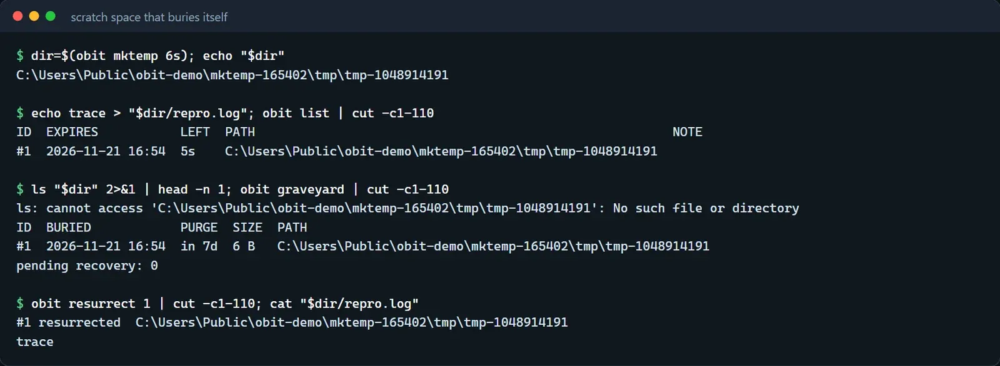

讣告的代码主要由 AI 写出来，而这个项目要解决的恰好是 AI 留下的东西。两件事叠在一起，开发过程本身就成了第一个试验场。这篇讲分工是怎么定下来的，什么时候要停下来等确认，以及我们自己怎样先踩了自己的坑。

## 谁决策，谁干活

分工大致是这样。一个人定方向和产品上的取舍。协调员，也就是 Claude，把大的目标拆成任务，给每个任务写任务书，核实每一条发现，合并交回来的改动，把关发版。worker 是 Codex，在各自独立的工作区里按任务书实现。审查员也是 Codex，只读，每个阶段有两三位，从不同的角度并行审同一份代码。调度靠 Orca，它负责起终端、派任务、收回报告。

这套分工有一条用出来的经验：需要判断的事放在协调这一侧，Codex 拿到明确的指令就动手干活，决策不要抛给它。任务书因此写得很具体，要做什么，不做什么，哪些文件不能碰，交回来的时候要带什么。11 月 8 日起，派 Codex 干活由我们自己写的一个委派脚本换成了 Orca 的编排功能。同一时间能跑多少个 worker 有上限，额度和机器都扛不住太多，这个上限也调整过几次。

## 闸门和证据

任务书里可以写闸门：做到某一步必须停下来，问过协调员，拿到回复才能继续。凡是不容易撤回的动作前面都设闸门，推送到共享仓库，发版，对外发布。闸门的意义在于，决定留在做决定的人手里，worker 可以把活做到只差最后一步。

交回来的东西要带证据，证据是真实的输出，不是转述。测试和变异检查的结果要附上，改回去之后测试确实会失败的验证要附上，截图和命令的输出要附上。同一个原则后来也用在对外的材料上：官网和用户文档讲具体的入口、效果和限制，视频里的命令在隔离的目录里实际执行，用它真实的结果，预览、待批准或者不能复活的情况不能说成已经支持。

审查有一条防止无限循环的规则。只有能删除、移动或覆盖错误对象的发现才算 HIGH，只能靠扩展路径或者 WSL 构造出来的名字触发、而且不会永久删错东西的算 MEDIUM 或 LOW，小修和只改测试的项目审一轮。11 月 21 日起，共享的站点仓库改由协调员合并和部署，worker 只推自己的分支。起因是一次 rebase 把整个样式表替换掉，误删了四组规则，验收只看了一张局部截图，没有发现。现在协调员逐行核对删除，在最新的 main 上合并，按最终的树构建，截受影响页面，再推送，并核对海外和国内的线上页面。

## 我们自己是第一个用户

最先出问题的是临时目录。worker 做测试和复现，会在系统临时目录里留下证据目录，11 月 10 日数了一下，有 70 多个，占了 2.4 GB，没有人记得去删。这正是讣告要解决的事，于是规矩改成：调试脚本、日志、复现和证据目录，用 `obit mktemp 2d` 创建，或者对已有的目录执行 `obit mark <路径> 2d`，到期自动下葬，还能复活。沙箱账户写不了账本的时候，才退回到在临时目录里手建，并在报告里写明。含 `.git` 的目录讣告拒绝登记，用完自己删。

<figure>
  
  <figcaption>worker 现在用的草稿空间，真实运行的结果。到期之后目录自己进了墓地，复活之后日志原样还在。</figcaption>
</figure>

还有一个 Windows 上的坑。Codex worker 以沙箱账户运行，Python 3.13 起，`mkdtemp` 在 Windows 上建的目录带受保护的 ACL。测试要是把临时目录指到那里，恢复 `.git` 的 ACL 就会失败，留下一个只有管理员能删的目录。所以测试用默认的临时目录，要清理这种目录得提权，对确切的目录执行 `takeown` 和 `icacls`，再用普通权限删掉。

11 月 14 日的事最能说明问题。worker 要测后台进程的 CPU，把正在用的讣告后台停了，换上自己编译的测试版，让它直接管着真实的数据，测完没有换回来。托盘只在后台程序所在的文件夹里找小窗口程序，测试版所在的临时文件夹里没有，托盘上的打开就变灰了，看上去只是点不动，看不到原因。修复分两层。眼前的那一层，让这一轮测完立刻换回正式版，以后的测试脚本退出时自动换回。产品上的那一层，缺少小窗口程序时，打开照样可以点，点了弹一条通知，说明缺什么、怎么修，这一条放进了 1.3.0。

还有一件事要提前安排。Orca 一重启，在跑的 worker 就会失联，所以重启之前要记下每个 worker 的会话 ID，重启之后按 ID 原样接回去。
