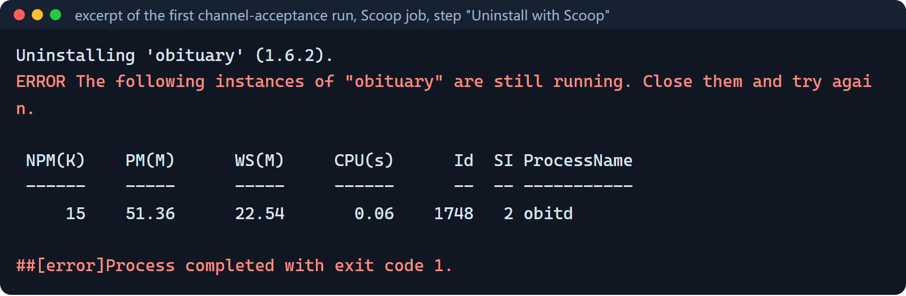
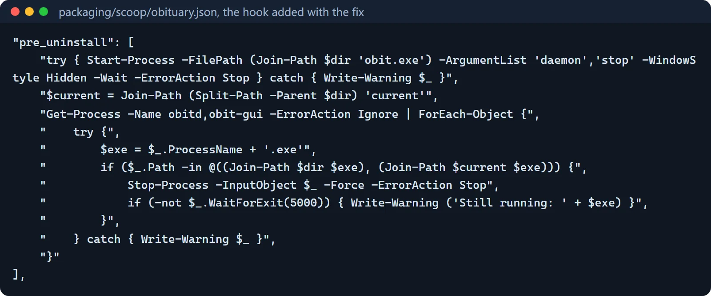

清单写对了，用户还不一定能顺利装上、卸干净。11 月 22 日我们让 Scoop 和 Homebrew 的客户端把 1.6.2 真装了一遍。

**第一次运行，两个渠道都在卸载这一步失败了。**

## 验收怎么跑：一个手动触发的工作流，三个作业

每次发版、两个渠道的索引都指向新版本之后，手动触发 `channel-acceptance.yml`，输入版本号，在 GitHub 的一次性机器上真装一遍。

| 作业 | 机器 | 卸载的路径 |
|---|---|---|
| Scoop，文档里的路径 | Windows | 先 `obit uninstall --yes`，再 `scoop uninstall obituary`，进程经 `current` 链接启动 |
| Scoop，直接路径 | Windows | 直接 `scoop uninstall obituary`，进程从带版本号的目录启动 |
| Homebrew | macOS 15 | 先 `obit uninstall --yes`，再 `brew uninstall --cask obituary` |

每个作业按同一份脚本走：

1. 读索引，核对里面的版本等于输入的版本。
2. 从渠道安装，`obit --version` 输出 `obit version <版本>`，`obitd --help` 能运行。
3. 对一个样本文件执行登记、列出、下葬、复活，用 `cmp` 核对复活后的内容和原文件逐字节相同。
4. 再下葬一次，让墓地里留着一份真实的内容，而不是一个空目录。
5. 让后台进程（Windows 上还有小窗口）都在运行，再用包管理器卸载。
6. 核对 `obit` 和 `obitd` 都从 PATH 里消失，`store.json` 和墓地目录与卸载前逐字节相同。

没有测到的：Windows arm64、Intel Mac、DMG，以及个人电脑上 Gatekeeper 的首次放行。

## Windows：后台进程还在跑，Scoop 不肯卸载

**`scoop uninstall obituary` 报"仍有 obituary 的实例在运行"，拒绝卸载，列出的进程是 `obitd`。**

<figure>
  
  <figcaption>第一次运行的真实日志摘录。验收脚本刚做完下葬和复活，讣告的后台进程 obitd 仍在运行，Scoop 因此拒绝卸载。</figcaption>
</figure>

真实用户也会碰到这个问题：装好讣告、用了一阵，托盘常驻进程一直在跑，这时直接 `scoop uninstall` 就会被拒绝。

我们最先试的是在验收脚本里卸载前先 `obit daemon stop`，那一次全绿了。但这等于替用户绕过了问题，所以没有留。最后的做法是从根上改 Scoop 清单，给它加一个卸载前的钩子：

- 先运行 `obit daemon stop`，让后台进程自己退出。
- 再找出 `obitd` 和 `obit-gui` 进程，只处理路径落在带版本号的目录或 `current` 目录下的，强制结束并等 5 秒，还没退出就给出警告。

两个路径都要覆盖，因为进程可能从带版本号的目录启动，也可能从 `current` 链接启动，这正是验收里有 Scoop 两个作业的原因。

<figure>
  
  <figcaption>清单里的卸载前钩子。只结束路径属于这次安装的 obitd 和 obit-gui，别的目录里的同名进程不会被碰到。</figcaption>
</figure>

**已经用旧清单装好的 1.6.2 不会自动拿到这个钩子。** 新装的用户和以后每次发版都会带上。

## macOS：新版 Homebrew 要先信任第三方 tap

第一次运行里，Homebrew 作业在读索引的那一步就停了，报 `Refusing to load cask ... from untrusted tap ...`，并提示用 `brew trust` 信任这个 cask 或这个 tap。

原因是我们在安装之前先用 `brew info` 读了 cask，新版 Homebrew 不愿意在信任之前加载第三方 tap 里的配方。

文档里的安装命令本来就是带 tap 名的完整名称，形如：

```bash
brew install --cask <tap>/obituary
```

用完整名称安装时 Homebrew 会自动信任这个 tap，所以 cask 和文档都不用改。要改的是验收脚本：安装前改为用 `git show HEAD:Casks/obituary.rb` 读索引里的配方，不加载它，装完之后再用 `brew info` 核对版本。

macOS 的卸载另有一段：先 `obit daemon enable` 装上 launchd 的用户代理，用 `launchctl kickstart` 让它真的跑起来，再 `obit uninstall --yes`，确认 plist 文件和已加载的服务都没有了（`launchctl print` 返回 113），最后 `brew uninstall --cask obituary` 并确认后台进程也不在了。

## 结果：三个作业全绿，数据逐字节保留

修完之后 1.6.2 在 Scoop（Windows x64）和 Homebrew（macOS arm64）上都能装上、能用，由各自的客户端卸载。两个程序都从 PATH 消失，隔离的账本和非空的墓地与卸载前逐字节相同。

这个流程在 11 月 22 日 19:46 合进 main。11 月 23 日 1.7.0 发布后我们又触发了一次，三个作业都用 1.7.0 通过。
