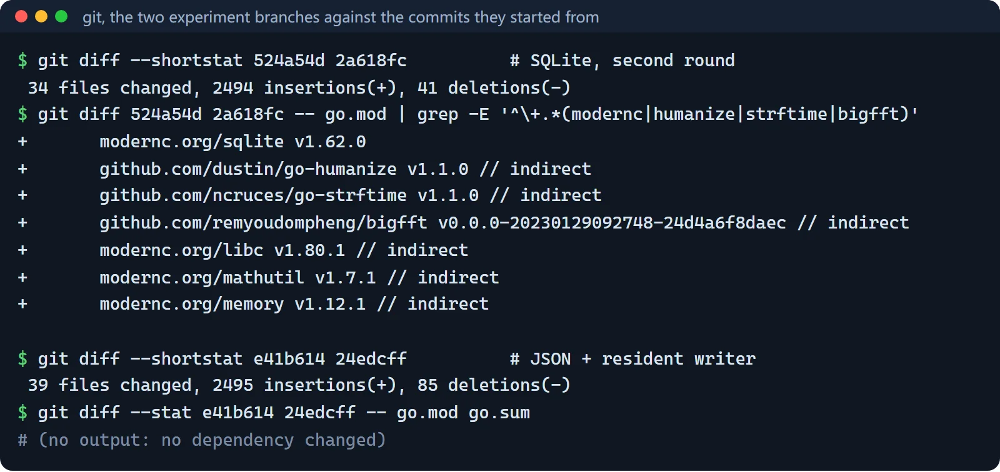

两条路都能把 16 个并发 hook 的 p95 压到 600 毫秒的门槛以内，我们这次选了账本格式不变的那条：JSON 加常驻单写者。

**在我们开发机上正在用的账本规模下（443 个活动条目、1080 个墓地条目，`store.json` 282 KB），SQLite 带来的额外收益不够抵它的代价。**

这篇把 SQLite 第二轮和 JSON 加常驻单写者的实测放进同一张表。11 月 9 日那篇《账本：JSON、SQLite，和一次没有合进去的重构》讲过更早的一次评估，那次搁置是在等常驻进程，这篇讲的是常驻进程有了之后又做的两轮。

## SQLite 做了两轮：指标过了大半，list 没过，建库有个缺口

11 月 22 日傍晚 A 批合进主线之后，B 和 C 批开始做。到 23 日下午，SQLite 分支停在 `2a618fc`。

第一轮把纯 Go 的 SQLite（modernc.org/sqlite v1.62.0）接了进来，写入只改变化的行，带幂等回执，测试都过了。但上层接口还是每次读整本账本，**一万条账本里改一行要 113 毫秒左右，门槛是 15 毫秒。**

第二轮把接口改成按行读写，常驻进程握着数据库连接，hook 经本机 IPC 把观察交给它。

过了的：

- 一万条账本里按 ID 改一行，p95 在 Windows 上是 5.33 毫秒，在 WSL 上是 7.13 毫秒，门槛 15 毫秒。
- 16 个 hook 同时跑，单个 hook p95 是 296.71 毫秒，整波 318.87 毫秒，门槛是 600 和 800，300 毫秒的冲刺目标也达到了。4 个和 8 个并发都比原来快。
- 常驻进程在两个关键点被强制退出，没有漏写，也没有重复写。

没过的：

- 16 个 hook 同时跑时，同期的 `obit list` 是 281.33 毫秒，门槛 250 毫秒。
- 短进程直接写和 JSON 比，中位数一样，p95 慢了约 7 毫秒，说不了"零散写不变慢"。
- 一部分写操作还没迁到按行写，老版本账本升级的全矩阵和全量 CI 也没做完。

**还有一个数据安全问题：第一次建库时，如果最后一步失败，会留下一个半成品的库，之后讣告打不开账本。**

具体是数据库已经提交，版本栅栏却没发布成功；普通的错误补偿把行恢复了，却没有恢复"这个库原本不存在"的状态，之后的读取报 `SQLite ledger exists without its version fence`。孤库不能当成空账本，也不能自动删掉，所以修法是给首次建库和导入加私有的暂存、归属和可重入的发布，并逐阶段模拟退出。这项做到一半就停了。

第二轮里查出并修掉的几个问题：

- 只读诊断（`doctor`、`init`、`uninstall`、MCP 四个包的测试）会修改 WAL 的侧车文件，原因是短连接被强制保留 WAL。
- 篡改栅栏里的墓地摘要之后，火化没有被拒绝，原来的测试在修复前实际得到的是 `purged`。
- Windows 上命名管道报 `Incorrect function`，现在限定当前用户的访问并在发送前核对端点的所有者。

## 暂停：慢的是排队和 Git，存储格式不是主因

第二轮的结果出来后，我们停下来重新看了一遍问题到底在哪。

三条事实放在一起：

- 并发时一个 hook 要一秒多，大头是每个 hook 都要锁住整本账本读写、还自己跑 Git。常驻进程当唯一写者能解决这个，和存储格式关系不大。
- 在 1000 + 1000 条的规模上，SQLite 的短进程直接写和 JSON 一样快，p95 是 85.78 毫秒对 83.87 毫秒。SQLite 的优势要到一万条以上才明显。
- SQLite 的代价已经看得见：程序多约 4 MiB，旧版本打不开新账本，多出新的故障点，做了三轮还没收敛。

**所以我们决定先暂停 SQLite，花一天验证"账本格式不变，只让常驻进程当唯一写者"能不能过同样的门槛。**

SQLite 的第三轮当场叫停。它没提交的改动（修建库孤库做到一半）存进了 git stash，分支原样留在 `2a618fc`。

## JSON 加常驻单写者：账本不变，写入搬到常驻进程

这一版的账本仍是 v18 的 JSON，写入的方式变了。

- **hook 只交观察。** PostToolUse 的写入经只允许当前用户访问的 Windows 命名管道（Unix 上是 socket）交给 `obitd`。回执表示队列已经持久化，不表示已经登记。没有常驻进程就走原来的直接登记；常驻已接单但 250 毫秒内没回执，hook 用同一个请求标识另存一份请求文件，不会多登。
- **回执即持久。** 同一时刻到达的请求合成一次写，写进每个版本都认得的 `observations.jsonl`。
- **常驻进程分批回放。** 每 32 条一批。Git、同意、规则和身份核对在不持 `store.lock` 的私有账本副本上做，提交时才取锁，并核对 `store.json` 的字节仍是读取时的字节，一批落一次盘，之后才删请求、冲洗审计。别的进程在这期间提交过，这一批重做，连续冲突三次就持锁做完。
- **读的一方不排队。** `obit list`、`obit stats` 和 hook 的通知读最近一次提交的 `store.json`，提交是原子改名，读到的总是完整的一版。

单写者的范围只到 Post 路径：CLI 的语义写和"已告知"标记仍然直接写账本。

## 并排：16 个并发时，两条路都过了 hook 门槛

下面是 1000 + 1000 条账本、真实的 `obit hook claude`、真实的 `obit list`、真实 Git 和一个无托盘的 `obitd` 测出的 p95。

<figure>
  
  <figcaption>三种实现的 p95。灰色是 11 月 22 日剖析时的 JSON，橙色是 SQLite 第二轮，蓝色是 JSON 加常驻单写者。三组数字不在同一次运行里，机器上同时还有别的任务，所以只拿来和各自的门槛比。</figcaption>
</figure>

| 指标（p95，毫秒） | 门槛 | 改造前的 JSON | SQLite 第二轮 | JSON + 常驻 |
|---|---|---:|---:|---:|
| 单个 hook，4 个并发 | 不比原来差 | 438.45 | 170.28 | 283.57 |
| 单个 hook，8 个并发 | 不比原来差 | 559.93 | 303.60 | 286.67 |
| 单个 hook，16 个并发 | 600（冲刺 300） | 1049.36 | 296.71 | 392.72 |
| 整波，16 个并发 | 800 | 1271.59 | 318.87 | 408.75 |
| 同期 `obit list`，16 个并发 | 250 | 468.73 | 281.33 | 357.09 |

两条路的判定一样：**hook 和整波都过了，同期的 list 都没过。** SQLite 的 hook 比 JSON 加常驻低约 100 毫秒，list 低约 76 毫秒。

JSON 加常驻在同一轮里还测了 main 作基线：单个 hook 980.16 毫秒，整波 1091.39 毫秒，list 347.49 毫秒。按各自同轮的基线算，SQLite 把 16 个并发的 hook p95 降到原来的约 28%，JSON 加常驻降到约 40%。冲刺目标 300 毫秒，JSON 加常驻只有三个时间窗里最安静的一个过了（293.4 毫秒，另外两个是 591.6 和 378.1）。

### 一万条账本

| 指标（p95，毫秒） | JSON，同轮的 main | SQLite 第二轮 | JSON + 常驻 |
|---|---:|---:|---:|
| 改一条记录 | 82.2（11 月 22 日剖析，中位数） | 5.33（持久连接，已预热） | 不按行改 |
| 单个 hook，16 个并发 | 1269.4 | 没量 | 396.4 |
| 整波，16 个并发 | 1339.9 | 没量 | 456.7 |
| 同期 list，16 个并发 | 642.4 | 没量 | 525.5 |

一万条的数字只有 15 波，p95 等于最大值，不设门槛。JSON 的"改一条记录"是另一次剖析的数字，驱动和 SQLite 那一行不同。

**JSON 加常驻在一万条时，hook 几乎不受规模影响，因为 hook 不再读写账本，规模的代价移到了常驻进程。** 每一批要把整本 JSON 重写两次（提交一次，审计出队一次），一万条时约 0.2 秒，这段时间 hook 不用等。

### 代价：登记完成得更晚

JSON 加常驻让 hook 先返回，登记在后台完成，所以从一波开始到全部进账本的时间变长了：

| 从波开始到全部登记（1000 + 1000 条，16 个并发） | 中位数 | p95 |
|---|---:|---:|
| JSON 基线 | 1.04 秒 | 1.20 秒 |
| JSON + 常驻 | 2.93 秒 | 3.44 秒 |
| SQLite 第二轮（波启动到清空） | | 6.92 秒 |

这是登记完成的时间，不是 agent 收到通知的时间。一万条时是 8.21 秒和 10.52 秒，基线是 6.80 秒和 11.29 秒。

## 代价与风险：体积、依赖、兼容、故障点

SQLite 把代价放在程序和格式上，JSON 加常驻把代价放在登记延迟和一段新的回放逻辑上。

<figure>
  
  <figcaption>两个实验分支停下来时和各自起点的差别。行数里测试和实验驱动占了不少，SQLite 第二轮是两千多行加一个新的依赖树，JSON 加常驻没有新依赖。</figcaption>
</figure>

| 项目 | SQLite 第二轮（`2a618fc`） | JSON + 常驻（`24edcff`） |
|---|---|---|
| 程序体积 | obit 加 4,199,936 字节，obitd 加 4,227,072 字节（Windows amd64，裁剪后），六个平台增量在 3.82 到 4.14 MiB 之间 | 没有单独量 |
| 新增依赖 | `modernc.org/sqlite` v1.62.0 和 6 个间接依赖 | 无，`go.mod` 和 `go.sum` 不变 |
| 常驻进程内存 | 没量 | 后来的 list 优化之后，负载下工作集 35 到 39 MB，基线 25 到 27 MB |
| 旧版本打开新账本 | 拒绝：格式号升高，旧账本要迁移，旧程序读到新格式会明确拒绝 | 能：v1.7.0 列出了 1000 条，它的 `obitd --once` 导入了排队的观察并各登记一次，新常驻进程重开账本后继续登记 |
| 非测试 Go 代码 | 16 个文件，增加 1798 行，删除 14 行，写操作还有一部分没迁 | 17 个文件，增加 862 行，删除 76 行，只覆盖 Post 路径 |
| 剩余工作的估算 | 审计时对 B 和 C 各估 5 到 8 个人日，还没做完迁移全矩阵 | 作者估计 8 到 12 个人日；要让健康时所有写都由 `obitd` 完成，再加 3 到 5 个人日 |

两边的故障注入结果：

- SQLite： 常驻进程在"队列写入前"和"提交后、回执前"两个点被强制退出，丢失和重复登记都是 0。这是带生产 IPC 处理器的一次性测试进程，不是对生产 `obitd` 的任意指令点杀。
- JSON + 常驻，1000 条： 真的 `obitd` 在随机时刻被 `TerminateProcess`，同时 hook 不停到达，两组共 560 次写入、50 次强杀，遗漏 0，重复 0。
- JSON + 常驻，一万条： 16 并发 × 20 轮，20 次强杀，320 个预期路径。驱动在 180 秒的排空期限内报了超时（已登记 298，待处理 22），**这次运行不能报通过。** 保留常驻继续运行后独立重读账本：一共 10,320 个活动条目，320 条各一次，修订号全是 1，遗漏 0，重复 0，队列清空。最后一次重启到最后一次提交相差约 191 秒。

这两项都是进程级的强杀，不是断电测试。

## 什么规模下哪个更合适

账本在几千条以内、瓶颈是锁排队和每个 hook 自己跑 Git 的时候，JSON 加常驻单写者更合适。账本上万条、每次提交整本重写的成本成了主要开销的时候，SQLite 更合适。

| 条件 | 更合适的做法 |
|---|---|
| 账本在几千条以内，慢在排队和 Git | JSON + 常驻 |
| 账本上万条，整本热账本的重写是秒级的主要开销 | SQLite，改一行 5 毫秒对 82 毫秒 |
| 旧版本必须还能打开账本，升级后能原样退回 | JSON + 常驻 |
| 可以接受多 4 MiB 体积、一次单向的格式迁移和一套新的故障点 | SQLite |

我们这次往 JSON 这边走，理由有四条：

1. 16 个并发的拖慢来自排队和 Git，单写者把它们都挪出了 hook。SQLite 在这一项上比 JSON 加常驻再低约 100 毫秒，两边都在 600 毫秒的门槛里。
2. list 在两条路上都没过 250 毫秒，SQLite 是 281 毫秒。后来的分段测量把 list 的慢拆到进程启动、每次重新解码和常驻进程的内存上限上，用 JSON 加常驻就解决了，没有换库，这些在下一篇里。
3. 我们自己账本的规模落在左边那一行，一万条以上才是 SQLite 占优的区域。
4. JSON 加常驻不改账本格式，1.7.0 能打开、能回放它写下的队列，不需要一次单向的迁移。

SQLite 的分支保留着，停在 `2a618fc`，随时能接着做，第一件事是首次建库留下孤库的那个缺口。要不要再给账本上行级写，等一万条以上的真实数据出来再定。

## 没有量到的

- 单跑和 2 个并发下的 hook 与 list：这两轮实验都没量。list 在单跑、2、4、8、16 个并发下的数字在下一篇里。
- SQLite 在一万条账本上的并发 hook、list 和常驻内存。
- 两条路没有在同一次运行里交错对照。历史的几列来自不同时段，机器也不是独占的。
- macOS 没跑，Linux 只在 WSL 下过了定向的测试。

两个分支到 11 月 24 日都还没合进 main，也没有发版。
