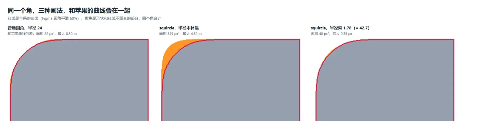
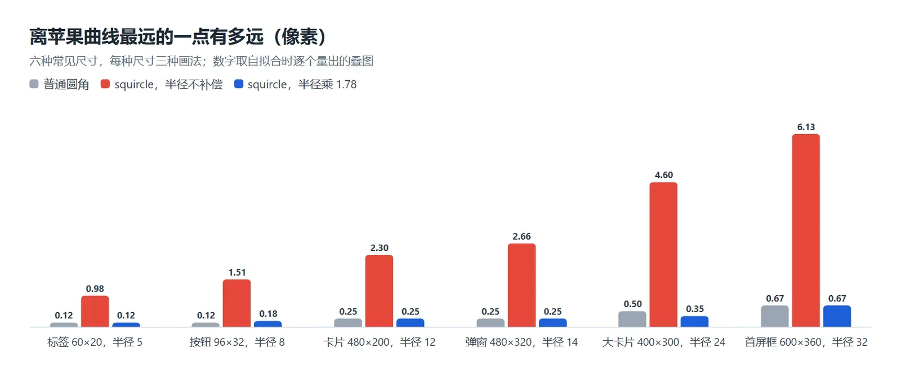
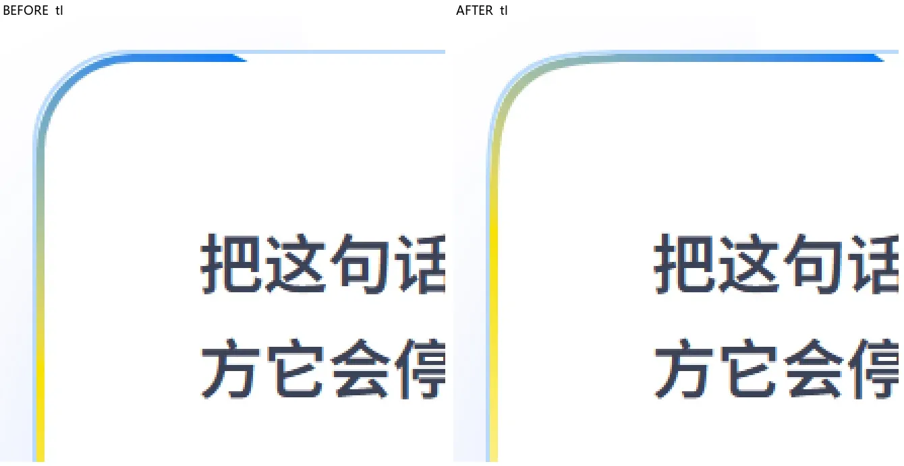
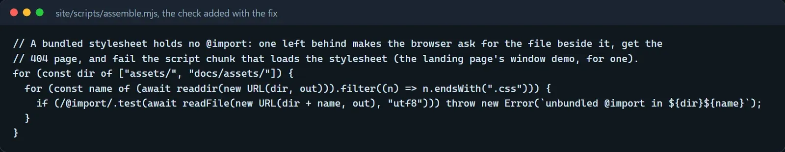

11 月 21 日下午 1 点 40 分，连续曲率的圆角合进了 main，小窗口、官网首页和文档站里的每一个圆角都变成了苹果那种平滑的曲线。

**3 分钟之后，官网首页变成一片白，海外站 39 分钟、国内站 41 分钟之后才恢复。**

这篇先讲圆角怎么做出来，再讲白屏。

## 想要的曲线：iOS 图标和卡片上那种圆角

曲线从直边上慢慢弯进来，没有圆弧突然开始的那一下。Chromium 和 WebView2 从 139 版起支持原生的 `corner-shape: squircle`，但是同一个半径下，squircle 切掉的角比圆弧少得多，看上去明显更方：

- squircle：对角线方向的深度是半径的 0.23 倍。
- 圆弧：0.41 倍。

所以直接把 `corner-shape` 打开，得到的不是想要的角。

## 拟合出 1.78：把半径放大

办法是把半径放大。参照是 Figma 的圆角平滑 60%，也就是 iOS 的那种角，用 figma-squircle 画出它的轮廓，只用来对比，不进产品。

拿 13 种尺寸去叠图，从 60×20 的标签到 600×360 的首屏框，半径从 5 到 32 像素，把图放大 2 到 8 倍，算像素差。每种尺寸的最佳比例都落在 1.77 到 1.79，浏览器会夹住的几种，也就是半径超过高度 0.28 倍的，不计入，20 像素高的标签是 1.73 到 1.81。

**定下来的比例是 1.78。**

放大之后和苹果的曲线对比：

| 指标 | 苹果 | 放大到 1.78 倍之后 |
|---|---|---|
| 对角线深度（半径的倍数） | 0.41 | 0.40 |
| 沿边起弯的长度（半径的倍数） | 1.6 | 1.78 |
| 轮廓和参照曲线的最大偏差，半径 8 像素 | | 0.18 像素 |
| 轮廓和参照曲线的最大偏差，半径 32 像素 | | 0.67 像素 |

<figure>
  
  <figcaption>拟合时的叠图之一，半径 24。红线是苹果的曲线，橙色是形状和它不重合的部分，补偿之后的 squircle 几乎贴着红线。</figcaption>
</figure>

<figure>
  
  <figcaption>三种画法离苹果曲线最远的一点有多远。不补偿的 squircle 随尺寸越来越方，乘 1.78 之后和普通圆角一样近。</figcaption>
</figure>

苹果的这条曲线和同半径的圆弧本来就只差半径的 2% 左右，8 像素差 0.1 像素，32 像素差 0.7 像素。所以在界面常用的半径上，肉眼看到的变化是弯道的入口更柔，圆弧突然开始的那一下没有了。想要更明显的方形，把 `--squircle-k` 调到 1.5 左右就可以，代价是偏离苹果的轮廓。

## 让构建来做：源码里仍然只写普通的 `border-radius`

一个 PostCSS 插件，`scripts/squircle-corners.mjs`，没有依赖，小窗口、官网首页和文档站三个构建都挂着它。它把每个圆角矩形的半径改写成 `calc(<半径> * var(--squircle-k, 1))`，再加上 `corner-shape: var(--squircle-shape, round)`。

这两个变量只在 `@supports (corner-shape: squircle)` 里定义：

- 支持的引擎得到新的形状。
- 不支持的引擎，Safari 和 WKWebView、WebKitGTK、Firefox，算出来的还是原来的半径和普通的圆角，像素和改动之前一样。

所以改一个地方全站跟着变，以后新写的圆角自动生效。

### 插件放过的，和不用的办法

插件放过的有：

- 百分比
- 100 像素及以上
- `calc(infinity * 1px)` 这样的胶囊
- 0 和 5 像素以下的半径

其他的约定：

- 开关、徽标这些用小像素写的胶囊，直接写成 `999px`。
- 内框紧贴外框的地方，外框手写成 `calc(var(--r) * var(--squircle-k, 1) + 内缩)`，不把同一个半径套到每一层。
- `border-radius: inherit` 会连形状一起继承。

没有用的办法：

- 用脚本算 SVG 路径再做 clip-path 或者 mask，因为那样会把边框、阴影和焦点环一起裁掉。
- 现成的 `postcss-smooth-corners`：它的比例写死在每条规则里，是 1.715，按面积匹配而不是按 Figma 的 60% 拟合，而且不处理用 `var()` 和 `calc()` 写的半径，小窗口里的半径令牌和 Tailwind 的半径都是这样写的。

### 验证：插件的测试，和逐像素的对比

插件有 11 个测试，故意改坏 7 处，都被抓到。

不支持的引擎一侧，同一份页面前后两套构建在 WebKit 里逐像素比较：

- 小窗口所有外观的页面、弹窗、卡片和按钮，以及文档站的全部截图，差异像素数都是 0。
- 官网首页里的静态元素也是 0，有差异的只有会动的部分，是时间不同造成的。

性能没有变化：官网首屏的 FCP 是 184 到 188 毫秒，LCP 是 448 毫秒，前后一样。CSS 的体积 gzip 之后，小窗口多 362 字节，官网多 367 字节，文档站多 163 字节，没有新增任何运行时脚本。

<figure>
  
  <figcaption>官网安装框左上角，改动前后。左边是改动前，右边是改动后，转圈的光线走到角上时和边框、外圈贴得更紧。</figcaption>
</figure>

## 首页一片白：`@import` 落进了 `@layer` 里

这些改动在下午 1 点 40 分合进了 main。1 点 43 分，海外站的官网首页开始变白，国内站从 1 点 53 分开始。

### 原因出在样式的组装上

小窗口的样式表开头引入了 `squircle.css`，而官网首页把整份小窗口样式包进了 `@layer gui`，好让小窗口里那条没有分层的 `button` 规则压不住官网自己的按钮样式。

合并之后，那条 `@import` 落进了层的里面，在那里导入是无效的，Vite 没有把它内联进去。线上，浏览器按相对路径去请求 `assets/squircle.css`，拿到的是 404 页面，拒绝把它当样式用，带着小窗口演示样式的那个懒加载分块也预加载失败，首页就空白了。中间有一次开发文档的部署带着同样的问题。

**受影响的只有官网首页，程序和下载包没有受影响。**

### 构建为什么是通过的

截图用的是生产构建的产物，但那是 rebase 之前的那一份。rebase 之后，双站的构建、文档和前端的检查都重新跑了一遍，没有再打开首页。

上线之后，最开始把样式 404 当成了边缘节点缓存暂时没同步，直到截图是空白的，浏览器控制台报告 CSS 预加载失败，才去查最终的产物。

### 下午 2 点 14 分的修复

官网构建现在把这一行从小窗口的样式里去掉，因为首页的 `index.css` 在顶层引入了同一个文件。`assemble.mjs` 里加了一道检查：构建完成之后扫描首页和文档站打包出来的每一份样式表，只要还留着一条 `@import`，构建就失败。

worker 分别在首页和文档站的产物里故意留下一条导入，两次都按预期失败，恢复之后构建通过，随后在海外和国内两处检查了首页和文档站。

| 站点 | 恢复时间 | 影响窗口（按 Pages 部署完成的时间算） |
|---|---|---|
| 海外站 | 2 点 22 分 | 39 分 10 秒 |
| 国内站 | 2 点 34 分 | 41 分 07 秒 |

<figure>
  
  <figcaption>修复里加进组装脚本的检查，只有七行。打包后的样式表里只要还有 @import，整个构建就失败。</figcaption>
</figure>

## 流程也改了：协调员合并和部署，截图必须在合并之后的最终生产树上截

共享的站点仓库由协调员合并和部署，worker 只推自己的分支，报告碰到了哪些共享的文件。协调员的步骤：

1. 逐行核对删除。
2. 在最新的 main 上合并。
3. 按最终的树构建。
4. 截受影响的页面。
5. 推送，分别回看海外和国内的线上页面。

**CI 绿了，或者某一个站点部署成功了，都不能代替这一步。截图必须在合并之后的最终生产树上截。**
