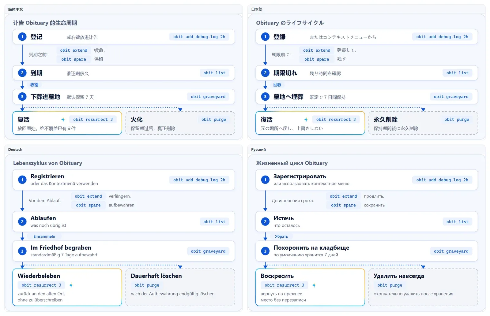
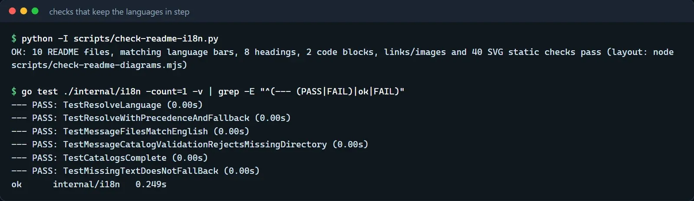
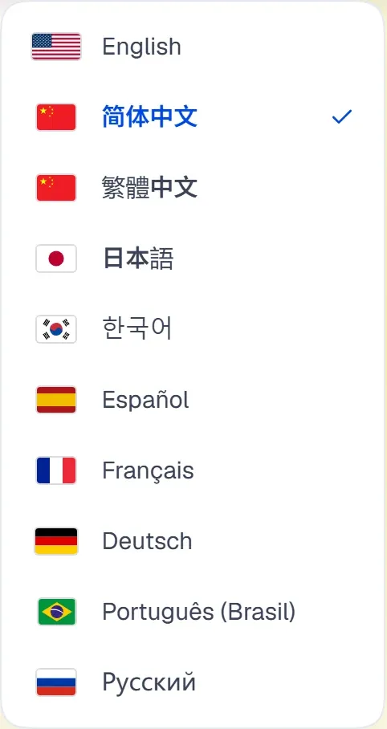

讣告的文字要给十种语言的读者看，最难的地方在翻译之后的同步和排版：一份文字改了，另外九份有没有跟着改；一张图里德语的词比中文长得多，会不会撑出框外。

**11 月 20 日下午 5 点半，十种语言的 README 合进了 main，到第二天清晨，官网和文档也有了十种语言。**

## 一份源文件，九份跟着走：英文 `README.md` 是唯一的源

每次修改，必须在同一次提交里同步另外九份：简体中文、繁体中文、日语、韩语、西班牙语、法语、德语、巴西葡萄牙语和俄语。十份文件第一行的语言栏完全相同，每种语言前面有一面国旗的 SVG，繁体中文也用中国国旗。

术语表把最常用的六个词在每种语言里固定下来，翻译的时候不再各自发挥。下面是其中五种语言的写法。`purge` 在非中文的文字里表示永久删除，中文保留火化这个比喻。

| English | 简体中文 | 日本語 | Deutsch | Русский |
|---|---|---|---|---|
| bury | 下葬 | 埋葬 | begraben | похоронить |
| graveyard | 墓地 | 墓地 | Friedhof | кладбище |
| resurrect | 复活 | 復活 | wiederbeleben | воскресить |
| lifespan | 寿命 | 寿命 | Lebensdauer | срок жизни |
| expire | 到期 | 期限切れ | ablaufen | истекать |
| register | 登记 | 登録 | registrieren | зарегистрировать |

## 图里的字，要在浏览器里量

README 里有两张图解，生命周期和删除护栏，每种语言有浅色和深色两个版本，一共 40 张。

- 图里的文字宽度一律在无头浏览器里用真实的字体量出来，同时按更宽的 Verdana 回退字体再留一份余量。
- 不靠估算字宽，也不用横向压缩。
- 说明文字在 880 px 宽度下不小于 14 px。

### 检查脚本 `pnpm check` 查什么

它取每段文字、每张卡片、每个命令框和每个箭头的真实边界框，查：

- 文字有没有重叠，有没有越出卡片或命令框
- 命令框是不是在自己的卡片里
- 间距和内边距够不够，有没有碰到箭头
- 对比度、孤字、行首标点
- 折行之后的文字和 `strings.json` 里的原文是不是一致

然后换成回退字体再查一遍。

### 检查脚本自己也要被检查

`pnpm test` 里有一批故意弄坏的图，证明脚本真能抓到问题。新增或放宽一条规则，都要加一张对应的坏图，再把规则临时关掉，确认测试会失败。

**检查全部通过之后，还要用无头浏览器逐张看图，脚本不替代眼睛。**

<figure>
  
  <figcaption>README 里的生命周期图解，10 个语言版本里的 4 个。德语和俄语的词比中文长得多，文字仍然都在各自的卡片里。</figcaption>
</figure>

SVG 是用本机的字体量的，CI 上的字体不同，所以 CI 只检查，不重新生成，这条规则和图解一起写在了 README 维护说明里。

## 软件里的文字：go-i18n，一份消息目录

新增用户看得到的文字，按这个顺序：

1. 在 `internal/i18n/messages.go` 里加一个稳定的、用点号分层的消息 ID 和英文默认文案。
2. 在 `active.zh-CN.json` 里加翻译。
3. 新增或修改消息之后运行 `goi18n extract`，检查两种语言的键和占位符。

英文源文案由 Go 里的消息定义维护，`active.en.json` 是可以提交的提取结果。两份目录都嵌进二进制。目前软件界面有英文和简体中文，新增语言就是复制 `active.zh-CN.json` 的键集合。

### 选哪种语言：固定的优先级

`OBIT_LANG`，配置项 `ui.language`，`LC_ALL`，`LC_MESSAGES`，`LANG`，最后是操作系统的界面语言。`zh-TW`、`zh-HK`、`zh-MO` 这样的繁体标签不能落到简体中文上。

### 不翻译的清单：给 agent 的东西保持字节稳定

- 删除护栏和 hook 的拒绝提示、等价命令
- 宿主协议的输出
- MCP 的工具名和描述
- JSON 字段、退出码、路径、版本前缀、日志标记、注册表键
- Wails 的数据字段

hook 的路径上也不加载语言目录。

下面是目录一致性的真实检查：README 的静态检查，和软件消息目录的测试，其中一条测的是缺了文字不会悄悄回退到别的语言。

<figure>
  
  <figcaption>保持各种语言同步的检查的真实运行。README 一边，软件消息目录一边，缺了文字会让测试失败，不会悄悄回退。</figcaption>
</figure>

## 官网的十种语言：构建时预渲染，从不自动跳转

11 月 21 日凌晨，官网也有了十种语言的页面：

- 简体中文在 `/`，繁体中文在 `/zh-TW/`，英文在 `/en/`，其余在 `/<语言码>/`。
- 每个页面都在构建时预渲染，带自己的 `<html lang>`、互相指向的 hreflang、canonical，整站有 `sitemap.xml` 和 `robots.txt`。
- 语言菜单里每种语言有一面旗。访客的浏览器语言和当前页面不同时，页面里会用访客自己的语言安静地提一句，从来不自动跳转。
- 第一屏和安装区跟着访客的系统走，Windows、macOS 或 Linux，也可以手动切换，切换时不会让版面跳动。
- 繁体中文、日语和韩语用访客系统自带的字体，只有简体中文用裁剪过的 Noto Sans SC。

<figure>
  
  <figcaption>官网的语言菜单。繁体中文也用中国国旗，当前页面所在的语言带着对勾。</figcaption>
</figure>

## 每种语言都逐行通读：找到的问题很具体

每种语言的页面都由一个专门的 worker 逐行通读，对照英文和简体中文的页面，以及这种语言 README 里的术语。11 月 21 日凌晨 5 点的那一轮通读，找到的问题：

- 日语的撤销按钮写成了重做，应该是元に戻す。
- 西班牙语的流程图写着可以复活 7 天，应该是 7 天内可以恢复。
- 德语里在墓地的几处介词，有七处应该是 auf den 或 auf dem Friedhof。
- 俄语的撤销按钮用成了取消。

### 几种语言共有的一处

非中文页面里的小窗口演示显示的是英文界面，英文界面的第二个页签叫 Graveyard，而从中文界面翻译过来的标签写着即将火化，和图、和图下面的文字都对不上，所以现在每种语言都写墓地。

### 排版

空头像位下面的标签超过 119 px 就用省略号截断，有五种语言放不下，换成了短标签，每个页面在 1440 和 390 px 宽度下都不再溢出。

文档的八个本地化首页也在同一天清晨重写，核心术语和官网、README 对齐，两个站点的构建里都加了对翻译页面的检查。
