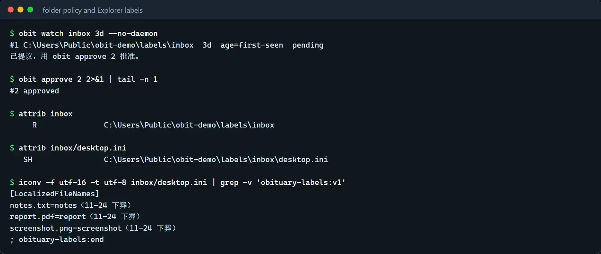

讣告从第一天起就以 agent 为先，给人用的那一半放在后面。但是批准一条提议，翻一遍墓地，复活一个文件，最后总是要人来做，不会用命令行的人碰到提议就卡住了。11 月 10 日一天里这一半补上了：下午两点多是右键菜单和文件夹策略，三点多是托盘进程，五点是小窗口的后端和资源管理器里的日期，晚上九点是 React 写的小窗口。

## 常驻一个小托盘进程

最初的设计里没有托盘，到期清理靠一个隐藏的、每 5 分钟跑一次的定时任务。定时任务做不了账本的单写者，也做不了实时的文件夹监视，所以 11 月 9 日傍晚我们决定改成默认常驻一个很小的托盘进程，就是 `obitd`。它在登录时启动，同一时间只有一个实例，兼任账本的单写者、文件夹监视和到期收割，自己不会主动弹窗。选型都是现成的：托盘图标用 fyne.io/systray，单实例靠 `x/sys/windows` 的命名互斥量，监视文件夹用 fsnotify，开机启动写当前用户的 Run 键，内存用 `debug.SetMemoryLimit` 兜住。定时任务退成托盘没开时的兜底。代价是改写了原先没有托盘的原则，常驻进程要自己管好内存和 CPU。

托盘菜单里有一项最近下葬的，列出墓地里最近的 10 条记录，人工删除和到期下葬的都在，显示名字、原目录、时间和来源，点哪一条就只复活那一条，走现有的全部安全检查，失败时在菜单里写明原因，不弹窗。命令行里本来有 `obit resurrect --last`，它按 agent 会话或当前项目来选要撤销的那一批。托盘进程没有会话，也不在任何项目里，把它搬过来就会变成撤销全机器最近的一批，可能复活用户并不想要的东西，所以托盘不调用它，多点一下换来的是只复活被点到的那一条。

## 小窗口

托盘菜单里的打开讣告会弹出一个小窗口，第一版有五页：墓地里搜索、复活和火化，待你决定里的提议和待信任的规则，即将到期里的续期和取消跟踪，设置里的文件夹策略、回收站模式、保留期、右键菜单和开机启动开关，以及日志。关掉窗口，只剩托盘图标。

界面选了 Wails：WebView2 加网页界面，后端直接复用现有的 Go 代码，不需要 C 编译器，以后 macOS 和 Linux 也能用。比较过的其他办法各有各的代价。纯 Win32 的库最小最快，但换平台就要重做，Fyne 和 webview_go 需要 C 编译器，Gio 的开发量太大，另写一个 C# 的 WinUI 要多一种语言。Wails 的代价是多一套界面要维护，窗口开着时预计 WebView2 要多占 50 到 100 MB 内存，关窗就释放，观感是网页风格。

下午五点半第一版的五页出来，晚上九点换成了 React 写的版本：默认是日历，每个条目落在它到期的那一天，另有八种外观，中英文双语。下面两张是今天这个窗口的样子，数据是演示用的，来自官网首页嵌进去的同一套组件。

<figure>
  
  <figcaption>小窗口的即将下葬页，日历外观。每张卡片是一个带寿命的文件或文件夹，落在到期的那一天，选中后可以续期或不再跟踪。</figcaption>
</figure>

<figure>
  
  <figcaption>待你决定页。提议按来源分组，写明为什么列在这里，批准或拒绝都不需要命令行。</figcaption>
</figure>

## 右键菜单和文件夹策略

右键菜单走的是经典的注册表方式，在 Windows 11 里出现在显示更多选项下面。选中一个或多个文件、文件夹，右键放进讣告，再选 1 天、7 天或 30 天，或者直接选现在埋掉，埋掉的东西可以复活。做完弹一条通知，说放进了几项、失败了几项。

文件夹策略把同样的事交给一个文件夹：`obit watch <文件夹> <寿命>` 给文件夹里每个顶层的文件或文件夹各一份寿命，默认从第一次看到它起算。这类策略要用户批准才生效，所以命令只提出一条提议，`obit approve` 之后才开始登记。在文件夹的空白处右键，菜单里也有设置文件夹策略这一项。

## 资源管理器里的日期

人在资源管理器里看不出哪些文件快被清走。办法是在文件所在的文件夹里放一个隐藏的 `desktop.ini`，写一节 `[LocalizedFileNames]`，让资源管理器显示一个带日期的名字，真实的文件名不变。显示的是下葬的日期，没有倒计时。默认只在下载、桌面和文件夹策略管的目录里打标签，Git 工作区默认不开，`config.toml` 的 `[explorer]` 可以关掉或扩大范围。

<figure>
  
  <figcaption>在演示目录里真实运行的结果。批准策略后，文件夹得到只读属性，desktop.ini 带系统和隐藏属性，里面每个文件一行显示名，文字固定为名字加月-日和下葬。</figcaption>
</figure>

这个办法有它的代价。文件夹里会多一个隐藏的 `desktop.ini`，文件夹本身要带上只读属性，这是微软文档里启用 desktop.ini 特殊行为的开关，`desktop.ini` 自己是带系统和隐藏属性的 Unicode 文本。资源管理器还有自己的缓存，续期之后同一个窗口最长约一分钟还显示上一轮的日期，我们试过八种刷新通知，没有一种能让它立即刷新。文件夹按 F2 改的只是显示名，真实的目录名不变，文件改名之后仍按文件 ID 继续跟踪。写 `desktop.ini` 用的也是持有句柄的办法，在一个句柄上核对再提交，用户原来写在里面的小节、数据流和属性原样保留，范围外已经写下的标签在下一次同步时撤掉。
