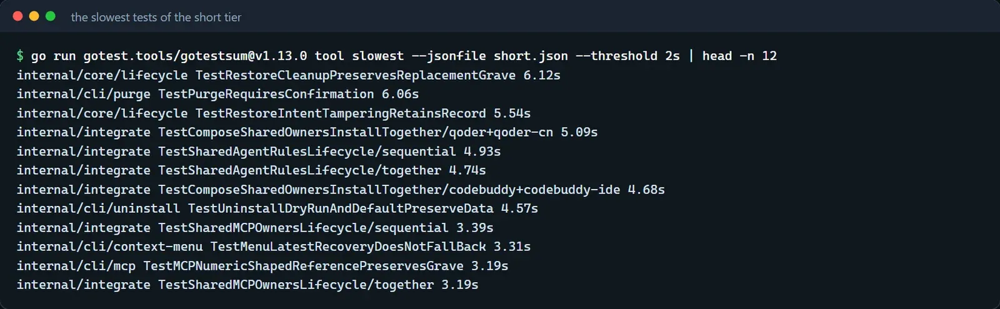

讣告的测试大多是集成测试：真的文件系统，真的 Git，真的 PowerShell。要证明的恰好就是这些真实的东西不会被弄错，所以测试不能全换成假的。代价是慢。11 月 10 日这台机器上同时有十来个 worker 在跑测试，慢变成了停工。

## 慢在哪里

同一套测试，在 GitHub 的空闲机器上，doctor 这个包 63 秒跑完。在本机几个 worker 同时跑全量时，它跑到 1500 秒的超时也没有结束，这时 CPU 只忙了大约 26%，时间花在磁盘、fsync 和创建进程上。每个测试都新建一个 Git 仓库，每次写账本都 fsync，PowerShell 每次启动大约 0.4 秒，doctor 的每个测试还要检查 30 家 agent。

11 月 9 日傍晚先定了一条规矩：开发途中只跑改动涉及的包，变异测试按名字只跑相关的几项，交付前全量和两组变异各跑一次。起因是有 worker 每修一处就把全量和两组变异重跑一遍，一个任务拖了几个小时。第二天下午又给 425 个顶层测试和 97 处子测试加上了并行，这碰不到上面任何一项开销。

## 两档

11 月 10 日的决定把规矩讲得更彻底。本机，不管是 worker 还是协调员，只跑改动涉及的包，开发时用 `go test -short`，慢的集成测试在 `-short` 下跳过，目标是机器空闲时整棵树的 `go test -short ./...` 在 60 秒内跑完。全量测试和两组变异只在 CI 上跑，CI 把它们拆成几个并行任务，每次列出最慢的 30 个测试，变慢的回归当场就看得到。

要让快档真的快，改了几处。测试二进制里默认不 fsync，像 SQLite 的测试用 `synchronous=OFF` 那样，专门测落盘顺序的测试照常打开，崩溃测试靠注入中断，不靠断电，覆盖面不变。Git 测试仓库每个包只建一次，之后从模板复制。doctor 的测试只检查自己要用的那几家 agent。大多数测试走到 Git 和 PowerShell 的地方换成了假的，只留少数真调用。做完之后，整棵树的 `go test -short ./...` 在空闲的机器上约 61 秒，同时跑着十一个 worker 时约 81 秒。此后代码和测试都多了不少，今天在这台机器上冷缓存重跑一遍整棵树的 `-short`，74 个包用了 110 秒，没有失败。

还有一个意外。Go 的测试驱动在每次运行结束后会重写体积达到几百 MB 的 testlog 文件，有个 worker 在屏幕上看到 ok 之后又等了十分钟。`testenv` 现在只在稳定的 Go 1.26.x 且格式完全认得的情况下压缩这个文件，格式不认识就一个字节都不动，每个进程只说明一次。

<figure>
  
  <figcaption>今天冷缓存跑完整棵树的 -short 之后，用 gotestsum 列出的最慢测试。超过 2 秒的一共 36 项，最慢的 6.12 秒，CI 每次也这样列出最慢的 30 个。</figcaption>
</figure>

## 账单

CI 的节奏是跟着账单定的。11 月 10 日全天每次推送都跑全量，仓库当时还是私有的，Windows runner 按两倍计费，一天下来大约 1284 个计费分钟。当天晚上就改了：推送和 PR 只在一台机器上跑 `-short` 快档，全量四个分片每晚在 main 有新提交时跑，也可以手动触发，变异每周跑一次，打包只在打包相关的文件改动时跑。代价也写在决定里：本机不再有全量的绿灯，`-short` 漏掉的问题最晚到第二天的夜间全量才会发现。

11 月 11 日仓库公开之后，标准 runner 不再计费，节奏又变回每次推送都跑全量：四个分片并行，加上 Linux 上带 `-race` 的测试和 macOS 上的 POSIX 测试，约 10 分钟出结果。变异测试按编号拆到 8 台机器并行，本地可以用 `OBIT_MUTATION_SHARD=k/n` 只跑其中的一份。

CI 里有一个排查出来的细节。测试必须从 pwsh 里跑，不能从 Git Bash 里跑：MSYS 的运行时会在提升过的令牌上启用备份和还原权限，所有子进程都继承了它们，测试里用来拒绝访问的 ACL 夹具就什么也拒绝不了。我们起初怀疑是 TEMP 路径太长，加了一个绕过办法，后来发现诊断错了，把它撤掉，改成从 pwsh 运行。

## 让测试碰不到真实的机器

测试多是真实的，就更要保证它们碰不到真实的用户环境。每个测试包的 `TestMain` 都调用 `testenv.Main(m)`，它把数据目录、配置目录、用户主目录和临时目录都指到一次性的目录，清掉继承来的 `GIT_*` 环境变量，换上专用的 gitconfig。右键菜单和开机启动项由 `OBIT_TEST_REGISTRY_ROOT` 重定向，测试进程和它启动的 `obit`、`obitd` 子进程都写到一次性的 `HKCU\Software\obituary-test-*` 下，这个名字前缀是硬性要求，不合格的值在打开任何注册表键之前就被拒绝。测试前后还会只读地比较真实的右键菜单、开机启动项、开始菜单和桌面快捷方式，有任何变化就让测试失败。临时目录所在卷的根下 `.obituary\graveyard` 的顶层条目也一样，多出来一项，就说明有东西漏到了真实的卷根。
