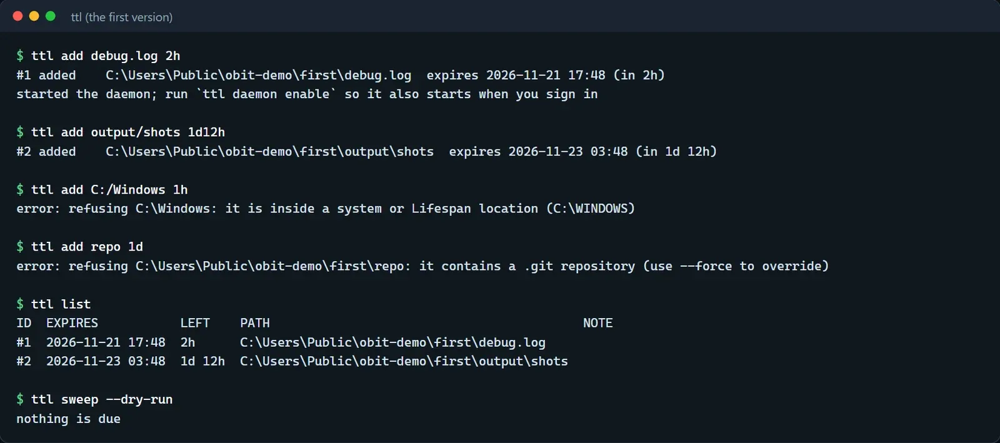

11 月 7 日是个周六。晚上十点多，我们想给某个文件或文件夹设一个存活时间，到点自动清掉。到那个晚上结束的时候，这个想法已经有了第一版代码，挨过一次审查，换了三轮名字，也有了今天的名字：讣告。

## 先看有没有人做过

我们先查了一轮。Windows 自带的办法有两种：用任务计划程序建一个一次性任务，到点执行 `Remove-Item`；或者用存储感知，按天数清理下载文件夹这类固定位置。前者要为每个文件写一段脚本，后者没法指定任意文件。第三方工具的思路几乎一样，盯住一个文件夹，清掉超过 N 天的文件，有收费的也有免费的，免费的不少已经多年没更新。它们都按文件夹写规则，单个文件这一级的倒计时没有人做，面向命令行和 AI agent 的用法也没有。

作为一门生意，这件事站不住。需求很小，愿意为它付费的人更少；核心功能只是定时删除，谁都能写；系统哪天加一条规则，它就失去了存在的理由；更大的文件自动化产品，也只是把它当作众多规则里的一条。所以我们没有打算做通用的文件整理规则引擎，也没有打算做云同步。

但有一个场景，现成的工具完全没有覆盖。AI agent 在工作区里会留下大量东西：调试脚本、日志、截图、测试产物、临时的 worktree。我们自己的规则文件里就有一条，要求任务结束时清理本次产生的临时文件。这条规则靠 agent 自己记得，而在很长的会话里，上下文压缩之后，早先读到的规则很容易被忘掉；记得的时候，清理常常是一条 `rm -rf`，删对了没有，没有人核对。

agent 在创建一个文件的那一刻，最清楚它是做什么用的、大概能活多久。如果它在那一刻顺手给文件写下一个寿命，到期由系统去处理，就不必再靠它记得。讣告的出发点就是这个：agent 产出的东西，从创建起就带着寿命。

## 十三分钟的第一版

决定动手之后，Claude 用大约十三分钟写出了第一版。它那时叫 Lifespan，命令是 `ttl`，有 `add`、`list`、`extend`、`cancel`、`sweep` 和 `log`，每个命令都能输出 JSON，方便脚本和 agent 调用。一个登录时启动的后台进程负责到期处理：东西通过系统的 `IFileOperation` 接口送进回收站，回收站放不下时不改成直接删除，而是保留文件，隔一阵再试。电脑关机或睡眠期间错过的到期项，开机或唤醒后补上。

文件靠身份认，不靠路径。身份是卷序列号加 128 位文件 ID，所以文件改名、移动之后仍然找得到，原路径上换了一个同名的新文件，也不会被碰。盘符根、系统目录和 Program Files 不能设寿命，用户文件夹本身也不能设，里面的东西可以；链接和 junction 一律拒绝；Git 仓库要加 `--force`，到期时还会再查一次。

<figure>
  
  <figcaption>用当晚第一版的源码重新构建后跑出来的输出：设寿命、拒绝系统目录和含 .git 的文件夹、按到期时间列出。</figcaption>
</figure>

一共 17 个测试，其中一个会真的把文件放进回收站，要设环境变量才跑。为了确认身份对不上就不删这条测试真能抓住问题，我们临时把判断改坏，看它会不会变红。第一次改坏之后变量没被用到，编译直接失败，等于什么也没验证，换了一种改法才看到测试失败。这件小事后来成了项目里的规矩：改回去的版本必须能编译，编译失败不算验证。

## 第一次审查

当晚我们没有急着把它装到日常用的机器上，先请两位 Codex 审查员只读地过了一遍代码，一位看防误删和 Windows API 的用法，另一位看并发、存储、后台进程和命令行。十来分钟后结果回来，一共 26 条，我们逐条打开代码核对，绝大多数成立。

最要紧的一类是认错对象。登记一个临时硬链接再删掉它，按文件 ID 找回时可能找到另一个名字，把重要文件送进回收站；8.3 短名（比如 `PROGRA~1`）和父目录是 junction 的路径，躲过了只做字符串比较的保护检查；下载、桌面被挪到别的盘之后，保护也只认默认位置。

第二类是检查出错时往放行的方向失败。`.git` 的检查只看第一层子目录，读取出错时还默认放行；文件被占用、权限不足这类暂时的错误，被当成文件已经没了，记录直接被丢掉。

第三类是状态和落盘。清理用的是开始时拍下的快照，清理途中被续期或取消的条目，后面仍然会被处理；写入前没有刷盘，断电可能丢更新；时长累加会溢出，十年的上限因此可以被绕过。

十三分钟写出来的版本，被审出这么多问题并不意外。认错对象这一类，也就是把眼前这个东西当成了当初登记的那一个，是删除工具最危险的时刻，它在后面一周里一再出现。接下来十几天的主要工作，就是让这个版本变得值得信任。

## 名字

Lifespan 和 `ttl` 谁也记不住，于是我们换了三轮名字。第一轮偏诗意，朝露、蜉蝣、昙花一类，不够抓人。第二轮转向到点收走的意象：生死簿，是传说里阎王手中记着每个人阳寿的那本簿子，英文叫 Grim。它很贴切，但和 Linux 上一个常用的截图命令同名。同一轮里还有希腊神话中剪断生命之线的 Atropos，一查，AI 圈里已经有同名的开源项目，搜索结果会被它压着。

第三轮我们先查撞名，再选名字。npm、Homebrew、PyPI、crates.io、Debian、Arch 上都没有同名的包，定下的是 Obituary，中文叫讣告，命令是 `obit`，后台进程是 `obitd`。命令词也跟着主题走，同时保留朴素的别名：`mark` 就是 `add`，`spare` 就是 `cancel`，`reap` 就是 `sweep`。

## 方向

名字定下来之后，方向也定了。讣告先为 AI agent 设计，hook、MCP 和 Skill 是一等入口，要做到一条命令装好、一条命令卸干净，也要照顾各家 agent 的差别；给人用的右键菜单和托盘排在后面。平台上先做原生 Windows，直接用文件身份和句柄，macOS 和 Linux 以后再说。工作方式是写、审、修：每写完一个阶段，请两位审查员读一遍，有问题就修，修完再请两位，循环到一轮没有严重问题，才进入下一阶段。后面的十几天，基本都是这样走过来的。语言用 Go，理由另有一篇。
