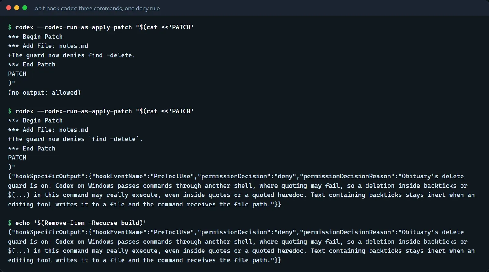

2026 年 11 月 19 日 22:57，我们在发布讣告 1.4.2。负责改文档的 Codex worker 用一条带引号 heredoc 的命令提交补丁，一分钟之内，项目的主工作目录 `D:\Coding\obituary` 被清空，`.git`、私有文档 `docs-internal/` 和未跟踪的 `.claude/` 都在里面。

**执行删除的，是写进发布说明里当例子用的一段文字：`find -delete`。**

事故后我们的第一个判断是「能拦下这条命令的修复就在 1.4.2 里，只是还没发布」。十几分钟后核对细节，发现这个判断错了：就算 1.4.2 已经装在机器上，它也会放行那条命令。

问题不在删除规则漏写了什么，而在护栏检查命令的时刻和命令真正被解析的时刻之间，隔着一次跨 shell 的转交，引号在那里变了样。

<figure>
  
  <figcaption>护栏站在第一道门前，看到的是一段文字；命令过了第二道门，被另一层 shell 重新读成了要执行的指令。</figcaption>
</figure>

## 事故是怎么发生的：下午刚补上一个洞，晚上同类的事在主检出里重演

讣告给文件设定寿命，到期下葬进可以复活的墓地，主要给 AI agent 用。它的删除护栏是一个在 agent 执行 shell 命令前触发的 hook，拦下命令位置上字面的 `rm`、`rmdir`、`git clean`、`Remove-Item`（含别名），能给出等价命令时建议改用可复活的 `obit` 命令。

我们开发时由一个协调的 agent（Claude Code）派活和审查，具体改动交给 Codex worker；在 Windows 上，worker 通过 WSL 里的 bash 执行命令。

### 下午：护栏补上 `find -delete`，一个 worker 的工作区被清空

- 16:00 前后，协调的 agent 在回复关于 AI 删文件的帖子时看到，有人在 X 上贴过 Claude Code 被禁了 `rm` 之后改用 `find -delete` 绕过去删。我们的护栏当时只认那四个字面的删除命令，拦不住这种写法，于是派了一个 Codex worker 在独立工作区 `guard-find` 里补。
- 16:57，这个 worker 提交测试补丁时，补丁里的 Bash 示例被意外执行，清空了它自己的工作区。操作前它没有未提交的跟踪改动，被跟踪的文件从 Git 恢复了；事前没有被忽略文件的清单，那部分有没有受影响无法核实。主检出和隔壁工作区都没受影响。
- 这和晚上那次是同一类事：补丁里的文字被当成命令执行了。只是这次删的是一份可以丢弃的副本，当时被当成一次小事故报告给了负责人。
- 17:09，修复 `b131063` 合进 main，护栏开始拦 `find . -name x -delete`、`find . -exec rm -rf {} +`、`find . -print0 | xargs rm -rf` 和 `xargs -0 rm`，只查找的 `find . -name '*.go'` 照常放行。

这类命令删的是一批事先不知道的文件，没法安全地改写成等价的 `obit` 命令，所以只拦不改写，提示 agent 先把要删的路径列出来核对，再交给 `obit rm`。

### 晚上发 1.4.2：两件事碰在了一起

- 协调的 agent 让发版 worker 直接在主检出 `D:\Coding\obituary`（bash 里是 `/mnt/d/Coding/obituary`）干活，没有给它独立工作区。
- 发版第 2 步要把协调的 agent 写的发布说明写进 `README.md`、`README.en.md`、官网文案和 `CHANGELOG.md`，这些文字里有 Markdown 反引号：`` `find -delete` ``、`` `find -exec rm` ``、`` `xargs rm` ``、`` `git clean` ``、`` `Remove-Item` ``、`` `obit rm` ``。

### 22:54 到 22:57：worker 重试，目录被清空

22:54:27，worker 第一次把补丁放进命令替换里的带引号 heredoc，交给 Codex 的应用补丁入口，但漏了 `cat`，返回 `Invalid patch`，文件没有变化。它问协调的 agent 能不能重试，得到的答复是可以，而且以后自己的命令写错、又没改动 GitHub、镜像或本机程序时，修好直接重试，不用先问。22:56:19，它补上 `cat` 重试：

```bash
codex --codex-run-as-apply-patch "$(cat <<'PATCH'
*** Begin Patch
*** Update File: README.md
@@
-- **怕 agent 一句 `rm -rf`。** ...
+- ... Bash 的 `find -delete`、`find -exec rm` 和 `xargs rm` 也会被拦下，但要先核对目标再用 `obit rm` 下葬。
...
*** Update File: CHANGELOG.md
@@
 - Fix: the delete guard now denies Bash `find -delete`, `find -exec rm`, and `xargs rm`, and explains how to list the targets first and bury them with `obit rm`.
...
*** End Patch
PATCH
)"
```

按 bash 的规则，带引号的 heredoc（`<<'PATCH'`）正文只是文字，里面的反引号不会执行。10 秒后，进程还在运行，输出是这样两轮：

```text
fatal: clean.requireForce defaults to true and neither -i, -n, nor -f given; refusing to clean
/bin/bash: line 1: Remove-Item: command not found
/bin/bash: line 1: obit: command not found
```

worker 中断进程后，又出现 `find: missing argument to '-exec'`、`rm: missing operand` 和 `fatal: not a git repository (or any parent up to mount point /mnt)`，最后补丁工具报 `README.md: No such file or directory`。

**22:57:02，`ls -la /mnt/d/Coding/obituary` 只剩 `total 0`。** 远端 main 还在 `8a05e62`，没有打标签，什么都没有发布出去。

证据有边界。工具没有记录引号失效之后 bash 实际收到的完整参数，worker 也没有重放那条命令。我们能确定的是 stderr 的顺序：`git clean` 拒绝执行，`Remove-Item` 和 `obit` 找不到，`find -exec` 缺参数，`rm` 缺操作数。这和「补丁文字里每一对反引号都被当成命令执行了」一致，其中 `find -delete` 没有写起始路径，就从当前目录开始删。删除发生在 WSL 的 bash 里，不经过回收站。

## 恢复靠的是三份互不相关的副本

22:58，协调的 agent 让 worker 停下，不再往 D 盘写任何东西，被删的数据可能还在磁盘上，写入会覆盖它们。盘点下来，代码全在 GitHub 上，main 和所有推送过的分支都在。

**风险最大的是私有文档 `docs-internal/`：它在 GitHub 上最新的一份是 11 月 13 日 15:51 推的，之后六天的改动都只在本机。**

协调的 agent 一边建议用 Windows File Recovery（`winfr`）从磁盘找回，一边只往 C 盘写，从另一条路恢复：

1. agent 每读写一次 `docs-internal/` 里的文件，全文都会留在 Claude 或 Codex 的会话记录里。
2. 当晚 20:17 有个 worker 在仓库里跑过一次 `git status`，输出也留在记录里，据此确认 11 月 13 日以后新增和修改的正好是 9 个文件。
3. 再从会话记录和 GitHub Release 的正文里一个个对上、复原。

负责人选择从 GitHub 重新 clone，23:15 两个仓库都回来了，9 个文件放回去并推送。真正找不回的，是 `.claude/worktrees` 下几个早期 agent 的旧工作区，以及可能存在、从没推送过的本地分支。

负责人当时问要不要把 PowerShell 删掉。这次动手的是 WSL 里的 bash，不是 PowerShell，删了它也一样会发生；Windows PowerShell 5.1 是系统组件，也卸不掉。

**危险的不是哪一个 shell，而是让自动化进程在唯一一份副本所在的目录里有写权限。**

## 第一个判断错在哪：护栏和真正执行命令的 shell 看到的不是同一个东西

23:11 向负责人报告时，协调的 agent 说：「1.4.2 一发，这类 `find -delete` 会被护栏拦下。」23:25，它在独立工作区里亲自发 1.4.2，构建还在跑，它回头核对那条命令，推翻了这个说法。

hook 在命令进入下一层 shell 之前运行，拿到的是 worker 提交的原文。在原文里，`` `find -delete` `` 落在 `<<'PATCH'` 这个带引号 heredoc 的正文里，按 bash 的语法就是普通文字，任何守规矩的解析器都会这么判断。

1.4.2 能拦的是直接写出来的 `find -delete`、`xargs rm`：升级前我们先测过，1.4.1 会放行 `find ./probe -name x -delete`；升级到 1.4.2 后，同样的测试被拒绝。但同样的字放在带引号的 heredoc 里，1.4.2 看到的仍然是一条安全的命令。

**把文字变成命令的，是 Windows 上的 Codex 把命令转交给 WSL 的 bash 那一步：引号这一层被弄坏，heredoc 实际上变成了不带引号的，反引号被当成命令替换执行。这一步发生在护栏之后，护栏看不到。**

同一次核对还发现一个配置上的盲区：这台机器上 Claude Code 的删除护栏只开了提示模式（`--notice-only`），只显示墓地提示，不拦删除命令；拦截只在 Codex 那边开着。负责人同意后，我们用 `obit init --guard-rm` 给 Claude Code 也打开了拦截。

## 1.4.3：把转交的那一层算进去，新规则 `EmbeddedDeletion` 只拒绝、不给等价命令

改护栏之前，先回到架构文档里的一条原则：拦得宽，等价命令给得窄。「是不是删除」和「能不能给出等价命令」是两件事。

- 拒绝本身不执行任何东西，所以可以宽。
- 等价命令必须逐字等价，给错了会删到别的东西，所以只在支持的子集里给。

别处的护栏宁可放过看不准的写法，也不给可能多选的等价命令；这次的新规则只拒绝、不给等价命令，所以可以更严。

11 月 20 日 00:38，一个 Codex worker 在工作区 `guard-backticks` 里交了初版（`78a6bcf`）。协调的 agent 审查时补了两处，00:54 提交（`2094645`），01:06 发布 1.4.3（`b6cae61`）。这条只对 Windows 上的 Codex 生效的规则叫 `EmbeddedDeletion`，有三处取舍。

### 不再相信引号和 heredoc 的边界

既然转交时引号可能失效，命令原文里的每一个反引号片段和 `$(…)` 片段，不论写在单引号、双引号、带引号的 heredoc 还是注释里，都拿出来检查，里面有删除就拒绝。

### 每个片段按 Bash 和 PowerShell 两种读法各查一遍

初版只按 Bash 读，审查时发现单引号里的 `'$(Remove-Item -Recurse x)'` 会漏过去。反引号只在类 Bash 的 shell 里执行，但 `$(…)` 在 Bash 和 PowerShell 里都执行。命令被转交以后，不知道最后是哪个 shell 读它，所以两种读法都要。

### 放在上下文检查之前，也不看当前目录

普通护栏先通过 `deleteGuardContext` 确定 shell、工作目录和可执行文件，为的是给出一条准确的 `obit` 等价命令。其中任何一项确定不了，比如 WSL 的工作目录、没有 Windows 工作目录的 PowerShell 声明、找不到 hook 程序，普通护栏就整个跳过。

新规则只拒绝、不给等价命令，用不到这些信息。如果它排在那一步后面，这些「确定不了」的情况就都成了绕过的口子。

拒绝理由按项目的规矩写成陈述句，只用 ASCII，告诉 agent：Codex 在 Windows 上会把命令交给另一层 shell，引号可能失效；带反引号的文字用编辑文件的工具写进文件，命令里只传文件路径。

<figure>
  
  <figcaption>1.4.3 在真实 hook 上的表现：同一段补丁，有没有那对反引号，决定了放行还是拒绝；单引号里的 $(Remove-Item …) 也被拒绝。</figcaption>
</figure>

测试覆盖了 PowerShell、嵌套片段、带引号的 heredoc、Windows 上带 POSIX 工作目录的 Codex 请求，以及普通 bash 读法下带引号 heredoc 仍然是文字的回归用例。作用范围、PowerShell 读法和嵌套递归这几个新判断各配了变异检查：故意把某一个判断关掉，测试必须失败。**新加的 5 个变异全部被抓到，完整的变异测试和 CI 也都通过。**

发布之后，我们把前一晚那条命令原样交给发布出来的 Windows 版本，结果是拒绝，普通命令照常放行。

## 规矩、没用上的沙箱，以及护栏的边界

1.4.3 只是兜底。当晚写进规矩的是：

- worker 不进主检出，只在独立工作区干活。
- 带反引号的文字用编辑文件的工具写，不经过 shell。
- 私有文档改完就推送。
- 启动长期运行的程序前先切回用户目录，不然它会锁住当前目录。

### 没有采用的办法：Codex 自带的操作系统级沙箱

23:30 到第二天 00:02 之间，我们还试过更彻底的办法：给 worker 套上 Codex 自带的操作系统级沙箱。在临时仓库里实测，它确实能挡住对工作区以外的写和删，越界会直接报 `Access is denied`。

但副作用也一样直接：在独立工作区里 `git commit` 会失败，因为提交要写主仓库的 `.git`，也被挡住了；联网也不通。直接切过去，所有 worker 都没法提交和推送。

自定义一份权限、放行自己的工作区、对应仓库的 `.git`、临时目录和网络，实测 `.git` 写入和联网还是不通。要调通得用管理员身份改 Windows 设置，worker 还得放弃 WSL 改用别的 shell，成本高，结果也不确定，所以暂时不做。

### 各道防线对当晚那条命令的效果

| 防线 | 状态 | 对当晚那条命令 |
|---|---|---|
| worker 只在独立工作区干活 | 已执行 | 兜得住，再来一次删的也只是可丢弃的副本 |
| 私有文档推到 GitHub | 已推送 | 兜得住，被删也能找回 |
| 带反引号的文字不经过 shell | 写进规矩 | 从源头避免，但要靠 worker 遵守 |
| 1.4.2 的删除护栏 | 已安装 | 拦不住，反引号在带引号的 heredoc 里，表面上只是文字 |
| 1.4.3 的 `EmbeddedDeletion` | 已发布 | 执行前直接拒绝 |

最后一行有它的上限：**护栏只认识删除命令。** 如果下一次引号坏掉后执行的是 `git reset --hard`，或者用 `>` 清空一个文件，护栏不会管。对这类操作，独立工作区是主要的保护。哪天要让 worker 跑来路不明的代码，或者再出一次类似的事，那时再花成本调通沙箱。

架构文档的威胁模型里因此多了一行：命令在 shell 之间转交时变了样。护栏能看到的只是命令的文本，看不到文本在各层 shell 之间怎么被重新解释。

这次能把六天的私有文档全部找回，靠的是 GitHub 上的代码、11 月 13 日那次推送，以及会话记录里碰巧留下的全文和 `git status` 输出。会话记录是一份没人刻意维护的意外备份，下一次不能指望它。
